# United Airlines Standby Opportunity Analytics (`united-standby-analytics`)

[](https://github.com/sir1602/united-standby-analytics/actions/workflows/ci.yml)

> **Non-Probability & Non-Affiliation Disclaimers:**
> 1. **0–100 Heuristic Index, NOT a Boarding Probability:** The **Standby Opportunity Index (`soi_historical` and `soi_planning`)** is a transparent, documented **0–100 relative opportunity heuristic** constructed strictly from public U.S. government aviation datasets (BTS On-Time Performance, BTS T-100 Segment, FAA Aircraft Registry, TSA daily checkpoint throughput) and curated public seat configurations. **It is NOT a probability of boarding.** No public dataset contains United Airlines gate standby lists, employee pass priorities (`SA1P`/`SA2`/buddy pass), hire-date seniority, revenue standby/SDC counts, or real-time weight-and-balance payload limits.
> 2. **Modeled Intraday / Day-of-Week Signals:** Hour-of-day and day-of-week differences reflect **BTS OTP operational signals and modeled TSA/hour-block demand adjustments** (`tsa_demand_multiplier`, `hour_block_multiplier`), **not** observed flight-level passenger loads.
> 3. **Independent Portfolio Project:** This project is **not affiliated with, endorsed by, or sponsored by United Airlines, Inc.** or its United Express regional partners.
> 4. **International Scope (`v1`):** BTS OTP covers U.S. domestic flights only; international departures (`51,673` `ORD` `UA` mainline departures / `75,512` UA-family departures across `2019` & `2023–2026-08`) are analyzed strictly at the `route × month × carrier` grain (`agg_route_month`, `data_granularity = 'route_month_only_v1'`). Flight-level international tracking via OpenSky Network / FlightAware AeroAPI is documented as a `v2` enhancement.

---

## Executive Overview

**United Airlines Standby Opportunity Analytics** models standby seat-availability dynamics for **employee / non-rev standby (`SA`)** travelers departing **Chicago O'Hare (`ORD`)** on **United Airlines mainline (`UA`)** and **United Express** regional partners (`OO`, `YX`, `YV`, `G7`, `C5`, `ZW`, plus pre-COVID 2019 partners `EV` and `AX`) across **`56` months (`2019` baseline + `2023-01` through `2026-08`, `830,941` scheduled domestic flights + `20,877` domestic & international route-months)**.

Because non-revenue standbys board last — behind all revenue passengers, Same-Day Confirmed travelers, and passengers reaccommodated from earlier disrupted flights — the pipeline computes two strictly leakage-separated `0–100` indices:
- **`soi_historical` (`n = 814,847` completed flights; `NULL` if cancelled):** Post-hoc operational audit using realized same-month BTS T-100 load factors, actual tail/cabin layout, realized earlier same-day cancellations/diversions, realized remaining non-cancelled backups, and actual `flight_date` TSA throughput.
- **`soi_planning` (`n = 626,838` `2023–2026` flights; `100% NULL` in `2019`):** Leakage-free advance trip-planning score using **only** schedule/calendar keys and hierarchical priors fitted strictly on prior calendar years (`train.year < eval.year`), scored across all scheduled flights (including flights that ultimately cancelled, avoiding survivorship bias).

---

## End-to-End Architecture

```mermaid
flowchart LR
    subgraph Raw["5 Public Sources (Checksummed via data/manifest.csv)"]
        OTP["BTS Marketing OTP<br/>(56 PREZIP zips | 830,941 ORD UA)"]
        T100["BTS T-100 Segment<br/>(5 FMG files | Dom + Intl)"]
        FAA["FAA Registry<br/>(MASTER + DEREG + ACFTREF)"]
        TSA["TSA Checkpoint Volumes<br/>(1,777 days | 2019, 2023-2026)"]
        LKP["BTS Lookups & reference/<br/>(31 subtypes, 56 crosswalk, 152 overrides)"]
    end

    subgraph Py["Python Pipeline (src/standby/)"]
        ING["Ingest & Pandera<br/>(ingest/ + schemas/)"]
        ENR["3-Tier Enrichment + SC-1..SC-5<br/>(enrichment/ + validation/sanity.py)"]
        SOI["Dual-Variant SOI & Validation<br/>(scoring/ + validation/soi_validation.py)"]
        EXP["Tableau & Looker Exporters<br/>(export/tableau.py & export/looker.py)"]
    end

    subgraph WH["BigQuery Warehouse & dbt Core (dbt/)"]
        BQ_RAW["raw.*<br/>(DATE partitioned on flight_date)"]
        DBT_STG["staging.* & intermediate.*<br/>(1:1 SQL parity w/ Python)"]
        DBT_MRT["marts.* (157 columns)<br/>fct_flights | agg_route_month | 4 dims"]
    end

    subgraph BI["Dual BI Extracts (exports/)"]
        CSV["Tableau: 8 Star-Schema CSVs (34.91 MiB)<br/>Looker Studio: 4 Pre-Joined CSVs (53.91 MiB)"]
    end

    Raw --> ING --> ENR --> SOI
    SOI --> BQ_RAW --> DBT_STG --> DBT_MRT
    SOI --> EXP --> CSV
```



---

## Data Sources & Acquisition

All raw files are verified for SHA-256 checksum and row count via [`data/manifest.csv`](data/manifest.csv) (`data/sample/manifest.csv` in CI) before ingestion. Exact scripted downloaders and manual TranStats form instructions live in [`docs/data_acquisition.md`](docs/data_acquisition.md).

| Source | Scope & Grain | Acquisition Method | Role in Pipeline |
|---|---|---|---|
| **BTS Marketing Carrier OTP (`PREZIP` / `FGK`)** | `56` monthly archives (`35.88M` U.S. rows → `830,941` `ORD` `UA`-marketed flights, `Duplicate='N'`) | Scripted `PREZIP` downloader (`src/standby/ingest/`) | Flight schedule, `TAIL_NUM`, delays, cancellations, diversions, backup counts |
| **BTS T-100 Segment All Carriers (`FMG`)** | `5` annual files (`CLASS='F'`, Domestic `DU`/`DF` + International `IU`/`IF`) | Scripted TranStats ASP.NET `POST` + documented form steps | Monthly capacity & passenger load factors (`fct_flights` + `agg_route_month`) |
| **BTS Reference Lookups** | `L_AIRPORT`, `L_AIRPORT_ID`, `L_AIRCRAFT_TYPE`, `L_UNIQUE_CARRIERS`, `L_CARRIER_HISTORY` | Scripted TranStats lookup downloader | Airport/carrier names, aircraft type labels, historical carrier eras |
| **FAA Aircraft Registry (`ReleasableAircraft.zip`)** | `MASTER.txt` + `DEREG.txt` + `ACFTREF.txt` (`702,892` registry rows) | Scripted FAA ZIP downloader | `N`-number → manufacturer/model (`TAIL_OVERRIDE → FAA_MASTER → FAA_DEREG`) |
| **TSA Daily Checkpoint Volumes** | `1,777` days (`2019` + `2023-01-01..2026-11-12`) | Scripted `tsa.gov` HTML table scraper | Daily passenger throughput for damped demand multiplier & `S_demand` |
| **Curated Reference Tables (`reference/` & `dbt/seeds/`)** | `seat_config.csv` (`31` subtypes), `faa_t100_crosswalk.csv` (`56` rules), `tail_overrides.csv` (`152` tails) | Version-controlled CSVs with `source_url` & `as_of` | Physical cabin seat capacity (`seats_config`), GA/Stearman guard, multi-config tails |

---

## Flight-Level Enrichment & Standby Opportunity Index Methodology

Full mathematical specifications and leakage boundary proofs are documented in [`docs/index_methodology.md`](docs/index_methodology.md) and [`docs/phase0_validation_report.md`](docs/phase0_validation_report.md).

1. **3-Tier Aircraft & Seat Resolution (`100.0000%` Performed Flights):**
   - Resolves `TAIL_NUM` strictly via `TAIL_OVERRIDE` (`152` curated overrides) → `FAA_MASTER` → `FAA_DEREG` (filtered to commercial airliner manufacturers and `faa_tc_max_seats >= 20`, rejecting `9,263` Stearman/GA/drone N-number collisions), achieving **`814,847 / 814,847` (`100.0000%`)** exact `seats_config` resolution on performed flights (`0` unmatched performed).
2. **3-Tier T-100 Load Factor Join & Modeled Adjustments:**
   - Domestic load factors resolve via `CARRIER_ROUTE_MONTH_TYPE` (`98.02%`) → `CARRIER_ROUTE_MONTH` (`1.98%`) → `ROUTE_MONTH` (`0.002%`), recorded in `lf_source`, with multi-brand CPA spokes (`OO`, `YX`, `2023 ZW`) flagged via `is_shared_regional_spoke`.
   - Base estimates (`est_load_factor`, `est_passengers`, `est_open_seats`) are kept separate from modeled adjustments (`est_lf_adjusted`, `est_open_seats_adjusted`), which apply damped monthly-relative TSA (`alpha = 0.35`, clipped `[0.80, 1.20]`) and 6 departure hour-block multipliers (`early` `05–08`: `0.96`, `morning` `08–11`: `1.03`, `midday` `11–14`: `1.00`, `afternoon` `14–17`: `1.02`, `evening` `17–20`: `1.04`, `late` `20–05`: `0.94`). Missing T-100 matches enforce **`SC-5` (`est_* = NULL`, `soi_* = NULL`)** — zero silent imputation.
3. **Standby Opportunity Index Formula (`0–100`, 4 Components):**

$$\text{SOI} = 0.50 \cdot S_{\text{open}} + 0.20 \cdot S_{\text{disp}} + 0.20 \cdot S_{\text{backup}} + 0.10 \cdot S_{\text{demand}}$$

| Component | Weight | Signal & Source |
|---|---:|---|
| **Open Seats ($S_{\text{open}}$)** | `50%` | 50/50 blend of adjusted open seats (cap `25`) and open cabin % (cap `30%`) |
| **Displacement Pressure ($S_{\text{disp}}$)** | `20%` | Exponentially decayed earlier same-day `ORD → DEST` cancellations/diversions (`hist`) or prior-year disruption rate $\hat{q} \times$ strictly earlier scheduled departures (`plan`) |
| **Backup Options ($S_{\text{backup}}$)** | `20%` | Logarithmic saturation curve ($\ln(1 + N_{\text{after}}) / \ln(7)$) over strictly later same-day departures to `DEST` |
| **Day / Holiday Demand ($S_{\text{demand}}$)** | `10%` | Annual-relative TSA checkpoint ratio (`tsa_ratio_year`) + deterministic 6-window US holiday calendar indicator |

- **Leakage Separation:** `soi_planning` fits all 4 prior hierarchies (`seats_config`, T-100 LF, disruption rate $\hat{q}$, TSA ratios) strictly on `train.year < eval.year` (so `2019` has `soi_planning = NULL`), whereas `soi_historical` uses realized flight-day outcomes (`is_cancelled = TRUE` → `NULL`). Both variants are implemented identically in Python (`src/standby/scoring/`) and `dbt` BigQuery SQL (`dbt/models/intermediate/int_flights_soi_scored.sql`).

---

## Empirical Validation & Key Results (`830,941` Flights)

| Pillar / Gate | Key Metric | Full-Dataset Result | Status / Threshold |
|---|---|---|---|
| **FAA Aircraft & Seat Resolution** | Performed flights (`814,847`) resolved to exact `seats_config` | **`100.0000%`** (`814,847 / 814,847`; `9,263` Stearman/GA collisions rejected) | **PASS** (`0` unmatched performed) |
| **Section 7 Sanity Checks** | `SC-1` bounds, `SC-2` OTP/T-100 (`+0.16%` ML), `SC-3` max seat diff (`5.68%`), `SC-4` UA LF (`82.89%`), `SC-5` zero imputation (`0` violations) | **`5 / 5` Passed** (`0` failures) | **PASS** |
| **Pillar 1: Fixed Holdout (`2025–2026`)** | Temporal consistency (`soi_planning` trained `2019,2023,2024` vs. `soi_historical`, `n = 309,930` paired) | **Spearman $\rho = 0.6530$**, **Top-Decile Lift = `5.31x`**, Coverage `99.22%` | **PASS** ($\rho \ge 0.55$, lift $\ge 3.0\times$) |
| **Pillar 1: Walk-Forward (`2023–2026`)** | Expanding `train.year < eval.year` (`n = 616,564` paired) | **Spearman $\rho = 0.6306$**, **Top-Decile Lift = `5.31x`**, Coverage `99.33%` | **PASS** (`2019` `soi_planning` = `100% NULL`) |
| **Pillar 2: Face Validity** | Peak holiday vs. off-peak trough (`soi_historical` mean) | **`late_jan_midweek` `76.99`** > `baseline` `61.73` > `spring_break` `59.32` > `christmas_peak` `51.78` > **`thanksgiving_sunday` `46.39`** (`+30.60` pts, Welch $t=86.31$) | **PASS** (Strictly monotonic, $p \approx 0.0$) |
| **Pillar 3: Weight Sensitivity** | Rank correlation across 5 alternative weightings (`seat_heavy`, `disruption_heavy`, `backup_heavy`, `equal`, `demand_heavy`) | **Min Spearman $\rho = 0.9010$** (`equal_weights`; `0.9222`–`0.9940` others) | **PASS** ($\rho \ge 0.85$) |

> **Mandatory Consistency vs. Ground Truth Caveat:** Both `soi_planning` and `soi_historical` rely on **BTS T-100 monthly load factors** as their capacity baseline because public aviation datasets do not contain flight-level gate standby clearance outcomes. Accordingly, **time-based backtesting measures temporal consistency between the advance-planning heuristic and the post-hoc operational proxy — NOT ground-truth non-rev boarding accuracy.**

---

## BigQuery Architecture & Partitioning Optimization

Full warehouse design, billing rules, and benchmark queries are documented in [`docs/bigquery_optimization.md`](docs/bigquery_optimization.md).

- **Billing-Enabled Free Tier (`D-08` — No BigQuery Sandbox):** BigQuery Sandbox enforces a mandatory **60-day partition expiration** based on `flight_date`, which would immediately delete all `2019` and historical `2023–2025` partitions. This project configures a **billing-enabled GCP project** (`$1.00` monthly budget alert, `partition_expiration_ms = NULL`), remaining `$0.00/month` within BigQuery's Free Tier (`10 GiB` active storage, `1 TiB` query processing/month; entire `raw` + `marts` footprint `< 0.9 GiB`).
- **Live Warehouse (`flight-standby-analytics`, `US`):** Datasets `raw`, `staging`, `intermediate`, and `marts` exist with no table or partition expiration. They currently hold the **committed `data/sample/` slice** (80 flights, 1,472 T-100 rows), not the full 830,941-flight dataset. All 19 dbt models are built and checked against the Python pipeline. See [`docs/bigquery_optimization.md` §7](docs/bigquery_optimization.md#7-live-warehouse-flight-standby-analytics) for what was verified and how to load the full data.
- **Partitioning & Clustering:** `raw.otp_marketing_flights` and `marts.fct_flights` use **`DAY` partitioning on `flight_date`** (`1,704` daily partitions across `2019` + `2023-01..2026-08`, `42.6%` of BigQuery's `4,000`-partition limit) and **`CLUSTER BY origin, dest, op_carrier`**.
- **Unpartitioned vs. Partition-Filtered Benchmark (`bq query --dry_run`):**
  - *Unpartitioned / Non-Prunable Baseline:* Scanning `_bench_fct_flights_unpartitioned` or filtering `marts.fct_flights` via `WHERE FORMAT_DATE('%Y-%m', flight_date) = '2025-07'` prevents partition elimination and scans all `1,704` daily partitions (`830,941` rows).
  - *Partition-Pruned + Clustered Query:* Filtering `WHERE flight_date BETWEEN DATE '2025-07-01' AND DATE '2025-07-31' AND origin = 'ORD' AND dest = 'DEN' AND op_carrier = 'UA'` eliminates `1,673 / 1,704` partitions (`~98.2%` partition elimination before clustering block pruning).
  - Verify exact byte counts against an authenticated GCP project with `$0.00` dry-run queries (`bq query --use_legacy_sql=false --dry_run --format=prettyjson ... | jq -r '.statistics.totalBytesProcessed'`). *Note: Because this repository's CI runs offline without GCP credentials, no live `totalBytesProcessed` counts are fabricated here.*

---

## BI Dashboards: Tableau Public & Google Looker Studio

This repository provides **two zero-cost BI delivery paths** from the same validated pipeline:

### 1. Tableau Public Dashboard: "United Standby Opportunity Explorer"
- **Tableau Public Link:** *(Pending user workbook publish — build from [`exports/tableau/`](exports/tableau/) following [`docs/tableau_dashboard_spec.md`](docs/tableau_dashboard_spec.md) §6 Publishing Checklist and replace this placeholder URL once published)*
- **Screenshot Preview:** `<!-- Add exported dashboard PNG screenshot at docs/assets/tableau_dashboard_preview.png once published to Tableau Public -->`
- **Deliverables (`exports/tableau/`):** `8` star-schema CSV extracts (`34.91 MiB` total, `< 50 MB` Git-safe; `fct_flights_tableau.csv` = `100,000` stratified rows across all 56 months & 9 carriers, `agg_route_month.csv` = `20,877` domestic + international route-months, `route_map_paths.csv` = `696` `ORD`-spoke path points using Tableau's built-in `Airport` geo role) + [`exports/tableau/export_metadata.json`](exports/tableau/export_metadata.json) + `22` copy-paste Tableau calculated fields in [`docs/tableau_dashboard_spec.md`](docs/tableau_dashboard_spec.md).

### 2. Google Looker Studio Dashboard (Zero-Blend Pre-Joined CSVs or Live BigQuery)
- **Specification & Setup Guide:** [`docs/looker_studio_dashboard_spec.md`](docs/looker_studio_dashboard_spec.md)
- **Deliverables (`exports/looker/`):** `4` pre-joined (denormalized) CSV extracts (`53.91 MiB` total, `< 50 MiB` per file) requiring **zero Data Blends** in Looker Studio's native File Upload connector:
  - [`exports/looker/looker_flights.csv`](exports/looker/looker_flights.csv) (`100,000` rows × `67` cols, `46.68 MiB`): `fct_flights_tableau` pre-joined with carrier, destination city/country, FAA aircraft model, chronological `day_of_week_label` (`1 - Mon`..`7 - Sun`), `hour_block_label` (`1 - Early`..`6 - Late`), and SOI tier labels.
  - [`exports/looker/looker_route_month.csv`](exports/looker/looker_route_month.csv) (`20,877` rows × `42` cols, `7.14 MiB`): `agg_route_month` pre-joined with carrier metadata, destination Google Maps `dest_geo_query` (`Geo -> Address`), and domestic OTP SOI monthly rollups (`otp_avg_soi_historical`, `otp_avg_soi_planning`).
  - [`exports/looker/looker_route_summary.csv`](exports/looker/looker_route_summary.csv) (`348` rows × `29` cols, `0.09 MiB`): 1 row per `(origin, dest, is_international)` route for Looker Studio's Google Maps Bubble Map and Destination Leaderboard.
  - [`exports/looker/looker_validation_summary.csv`](exports/looker/looker_validation_summary.csv) (`45` rows × `7` cols) + [`exports/looker/export_metadata.json`](exports/looker/export_metadata.json).

```text
+---------------------------------------------------------------------------------------------------+
| UNITED STANDBY OPPORTUNITY EXPLORER (ORD HUB)                                [Index Mode: Plan v] |
| [!] 0-100 Heuristic — NOT a Boarding Probability | Hour/day deltas = OTP + modeled adjustments    |
+---------------------------------------------------------------------------------------------------+
| Selected SOI: 58.1 | T-100 LF: 82.8% | Dep Delay 15+: 22.2% | Cancel: 2.0% | Open: 19.2 (Med 14.0)|
+---------------------------------------------------+-----------------------------------------------+
| VIEW 2: ORD Hub-and-Spoke Route Map (348 dests)   | VIEW 3: Hour-Block x Day-of-Week SOI Heatmap  |
| VIEW 4: Route & Carrier Drill-Down (Shared CPA)   | VIEW 5: Holiday & TSA Seasonal Demand Curve   |
| VIEW 6: Fleet Subtype & Cabin Capacity (31 types) | VIEW 7: Intl Route-Month (v1) + Val Scorecard |
| VIEW 8: Historical Trend & 2019 Baseline Compare  | VIEW 9: Flight-Level Detail (tier + lf_source)|
+---------------------------------------------------+-----------------------------------------------+
```

---

## Assumptions, Limitations & `v2` Roadmap

1. **No Ground-Truth Gate Standby Data:** Public datasets omit standby lists, pass priorities (`SA1P`/`SA2`/buddy pass), hire-date seniority, revenue standby/SDC, and weight-and-balance payload restrictions; `SOI` is strictly a relative `0–100` heuristic, never a boarding probability.
2. **Monthly Load Factor Smoothing & Modeled Intraday Adjustments:** BTS T-100 provides monthly `carrier × route × aircraft_type` aggregates. Intraday and day-of-week variations come from BTS OTP schedule/delay/cancellation/backup signals and modeled TSA/hour-block multipliers (`alpha = 0.35`), not observed flight-level loads.
3. **Shared Multi-Brand Regional CPA Carriers:** `OO` (SkyWest), `YX` (Republic), and `2023 ZW` (Air Wisconsin) report combined `UA`/`AA`/`DL` T-100 traffic under `UNIQUE_CARRIER` (`is_shared_regional_spoke = TRUE` on `76,446` flights).
4. **Curated Point-in-Time Cabin Configurations (`as_of = 2026-08-31`):** `reference/seat_config.csv` (`31` subtypes) and `tail_overrides.csv` (`152` tails) capture major multi-config sub-fleets (`777-200` `364` vs `276`, `757-200`, `767-300ER`, `E175`) without scraping United.com.
5. **`v2` Enhancement Roadmap:**
   - **Flight-Level International Tracking (`v2`):** Extend beyond `v1` T-100 monthly route-level international analysis (`agg_route_month`) using OpenSky Network ADS-B or FlightAware AeroAPI tail/schedule feeds.
   - **Multi-Hub Expansion (`v2`):** Add additional United hubs (`DEN`, `IAH`, `EWR`, `SFO`, `IAD`, `LAX`) solely via `config/standby.yaml` and `dbt` `vars` without pipeline code changes.

---

## Documentation & Deliverables Index

| Document / Artifact | Purpose |
|---|---|
| [`docs/phase0_validation_report.md`](docs/phase0_validation_report.md) | Phase 0 empirical inspection across all 5 raw sources (`35.88M` U.S. rows, Marketing vs. Reporting OTP proof, `DEREG.txt` lift, 6+3 data quirks, 11 limitations) |
| [`docs/data_acquisition.md`](docs/data_acquisition.md) | Scripted & manual browser download instructions + SHA-256 `data/manifest.csv` contract |
| [`docs/index_methodology.md`](docs/index_methodology.md) | Complete mathematical specification, leakage boundary matrix, and Section 6 empirical validation results (`docs/phase4_validation_summary.json`) |
| [`docs/data_dictionary.md`](docs/data_dictionary.md) | Full column-level specification for all **`157` BigQuery mart columns** (`actual`/`derived`/`estimated`) + Tableau & Looker Studio CSV projections |
| [`docs/tableau_dashboard_spec.md`](docs/tableau_dashboard_spec.md) | **"United Standby Opportunity Explorer"** Tableau Public wireframe, relationships, `22` calculated fields, `9` views, `6` filters, and `4` mandatory disclaimers |
| [`docs/looker_studio_dashboard_spec.md`](docs/looker_studio_dashboard_spec.md) | **Google Looker Studio** 4-page build guide, zero-blend pre-joined CSV setup, Google Maps `dest_geo_query` config, and `SOI Mode` parameter formulas |
| [`docs/bigquery_optimization.md`](docs/bigquery_optimization.md) | Billing-enabled BigQuery setup (`D-08`, why Sandbox's 60-day expiry fails), `DAY(flight_date)` partitioning, clustering, and unpartitioned vs. pruned `bq query --dry_run` SQL |
| [`docs/decisions.md`](docs/decisions.md) | Full Technical Decisions & Assumptions Log (**`D-01` through `D-39`**) |
| [`exports/tableau/`](exports/tableau/) | 8 validated Tableau star-schema CSV extracts (`34.91 MiB` total; `fct_flights_tableau.csv` stratified `100k` rows) + `export_metadata.json` |
| [`exports/looker/`](exports/looker/) | 4 validated Looker Studio pre-joined CSV extracts (`53.91 MiB` total; `looker_flights.csv` stratified `100k` rows) + `export_metadata.json` |
| [`notebooks/00_phase0_validation.ipynb`](notebooks/00_phase0_validation.ipynb) | Executed Phase 0 EDA reproduction notebook |

---

## Repository Structure

```text
united-standby-analytics/
├── config/                  # config/standby.yaml (hubs, carriers, years, SOI weights, export config)
├── data/
│   ├── raw/                 # Git-ignored raw BTS, FAA, and TSA archives (verified via data/manifest.csv)
│   └── sample/              # Committed CI sample slice (13 files, verified via data/sample/manifest.csv)
├── dbt/                     # dbt Core BigQuery project (raw -> staging -> intermediate -> marts)
├── docs/                    # Validation reports, methodology, 157-col data dictionary, Tableau/Looker & BQ specs
├── exports/
│   ├── tableau/             # Committed Tableau star-schema CSV extracts (<50 MB per file) + export_metadata.json
│   └── looker/              # Committed Looker Studio pre-joined CSV extracts (<50 MB per file) + export_metadata.json
├── notebooks/               # Executed Phase 0 EDA notebook
├── reference/               # Curated seat_config.csv (31), faa_t100_crosswalk.csv (56), tail_overrides.csv (152)
├── src/standby/             # Python CLI & package (ingest, manifest, schemas, enrichment, scoring, validation, export, load)
└── tests/                   # Comprehensive pytest suite (sample integration, leakage tests, dbt SQLite parity, export invariants)
```

---

## Project Phasing & Roadmap (One PR per Phase)

| Phase | PR | Milestone & Deliverables | Status |
|---|---|---|---|
| **Phase 0** | **PR #1** | Phase 0 Empirical Validation Report + Architecture Proposal (*Stop Gate 1*) | **Merged (`main`)** |
| **Phase 1** | **PR #2** | Ingestion + Checksummed `data/manifest.csv` + `data/sample/` + `pandera` Schemas + BigQuery `raw` Batch Load + CI | **Merged (`main`)** |
| **Phase 2** | **PR #3** | Flight-Level Enrichment + Curated Reference Tables (`reference/`) + Section 7 Sanity Checks (*Stop Gate 2*) | **Merged (`main`)** |
| **Phase 3** | **PR #4** | `dbt Core` (`staging` → `intermediate` → `marts`) + Zero-Dependency Schema Tests & Offline CI | **Merged (`main`)** |
| **Phase 4** | **PR #5** | Standby Opportunity Index (`soi_historical` + `soi_planning`) + 3-Pillar Section 6 Validation Suite (*Stop Gate 3*) | **Merged (`main`)** |
| **Phase 5** | [**PR #9**](https://github.com/sir1602/united-standby-analytics/pull/9) | Tableau Public & Looker Studio Extracts (`exports/`) + Dashboard Specs + 157-Col Data Dictionary + BigQuery Guide + Final README | **Merged (`main`)** |

---

## Quickstart (Local & CI Reproduction)

```bash
# 1. Install pinned environment via uv
make setup

# 2. Verify SHA-256 checksum manifests (sample + full raw)
make manifest

# 3. Run code quality, full pytest suite (against data/sample/), and offline dbt parse/compile/docs
make lint
make format-check
make test
make dbt-parse
make dbt-compile
make dbt-docs

# 4. Run end-to-end sample dry-run & Tableau / Looker sample exports (<10s, zero GCP secrets required;
#    sample extracts go to gitignored data/processed/sample/{tableau,looker}/, never exports/)
make ingest-sample
make score-sample
make validate-index-sample
make export-tableau-sample
make export-looker-sample

# 5. Run full 830,941-flight pipeline, Section 6 validation, and Tableau & Looker CSV exports
#    (requires data/raw/ per docs/data_acquisition.md; `make run` is a --dry-run that writes
#    local Parquet to gitignored data/processed/full/, so no GCP credentials are needed)
make run
make validate-index
make export-tableau
make export-looker

# 6. Optional live BigQuery load into `flight-standby-analytics` (config/standby.yaml; override
#    with GCP_PROJECT_ID, which dbt reads too): authenticate with
#    `gcloud auth application-default login`, then load raw and build/test the dbt marts
#    (bq-load fails fast with BigQueryCredentialsError if no credentials are found;
#    `make bq-load SAMPLE=1` loads the committed sample slice instead of data/raw/)
make bq-load
make dbt-build
```

### CLI Options for `export-tableau` & `export-looker`
```bash
# Default: 100,000-row stratified sample across (year, month, op_carrier), seed=42 (<50 MB Git-safe)
.venv/bin/python -m standby export-tableau --hub ORD --years 2019,2023-2026
.venv/bin/python -m standby export-looker --hub ORD --years 2019,2023-2026

# Recent 12 months slice (or full 830,941-row local extract written to gitignored exports/{tableau,looker}/full/)
.venv/bin/python -m standby export-tableau --flight-mode recent-12m
.venv/bin/python -m standby export-looker --flight-mode recent-12m
```

Switching flight modes in one output directory removes the other mode's flight file only if the previous export there wrote it (it is listed in that directory's `export_metadata.json`); any other file, such as a `fct_flights_tableau_full.csv` left in `exports/tableau/` by an older version, is kept with a warning. Pointing `--output-dir exports/tableau` (or `exports/looker`) at a `--sample` or `--flight-mode full` run replaces the committed extracts; restore them with `git checkout -- exports/tableau exports/looker`.
