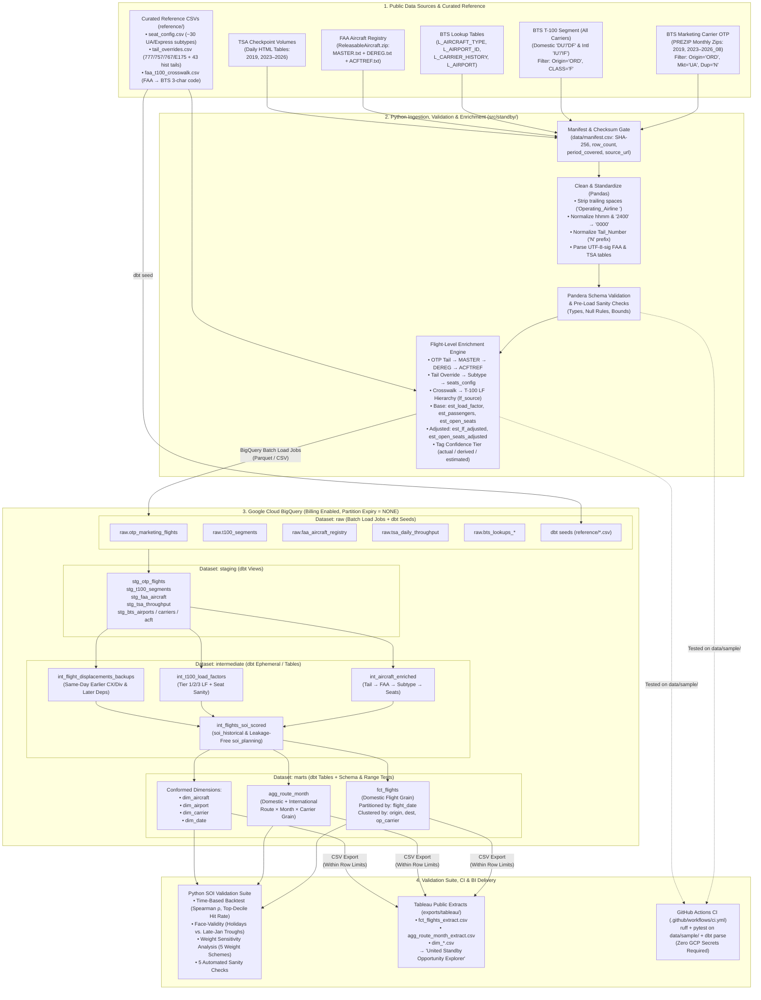

# Phase 0 Validation Report & Architecture Proposal: United Airlines Standby Opportunity Analytics (`ORD` Hub)

> **Important Disclaimers:**
> 1. **Heuristic Index, Not a Boarding Probability:** No public dataset contains actual United Airlines gate standby lists, cleared vs. bumped non-rev passenger counts, employee pass priority/seniority rankings, or real-time weight-and-balance restrictions. The **Standby Opportunity Index (`soi_historical` and `soi_planning`)** is a transparent, documented **0–100 relative opportunity heuristic** built strictly from public U.S. government aviation data (BTS, FAA, TSA) and curated public fleet specifications — **never a probability of boarding**.
> 2. **Non-Affiliation:** This portfolio project is an independent data engineering and analytics engineering exercise and is **not affiliated with, endorsed by, or sponsored by United Airlines, Inc.**

---

## 1. Executive Summary

Before writing any production pipeline code (`src/standby/` or `dbt/`), we downloaded and empirically inspected **100% of the actual raw data files** across all five public data sources in `/home/antigravity/united-standby-analytics/data/raw/`:
- **56 monthly BTS Marketing Carrier On-Time Performance (`PREZIP`) archives** covering `2019-01` through `2019-12` (12 months) and `2023-01` through `2026-08` (44 months): **35,881,885 total U.S. flights**, **1,637,491 `ORD` departures across all carriers**, and **830,941 `ORD` departures marketed by United Airlines (`Marketing_Airline_Network = 'UA'`, `Duplicate = 'N'`)**.
- **1 monthly BTS Reporting Carrier OTP archive (`2024-01`)** (`547,271` U.S. rows, `20,321` `ORD` rows) to empirically prove why Reporting Carrier OTP cannot satisfy the project scope and why Marketing Carrier OTP is required.
- **5 annual BTS T-100 Segment (All Carriers — Domestic & International, `gnoyr_VQ=FMG`) archives** (`2019`, `2023`, `2024`, `2025`, `2026` through `2026-08`): **2,520,139 total segment rows** and **75,863 `ORD` scheduled passenger service (`CLASS = 'F'`) rows**.
- **5 BTS Lookup tables**: `L_AIRCRAFT_TYPE.csv` (`453` rows), `L_AIRPORT_ID.csv` (`6,918` rows), `L_CARRIER_HISTORY.csv` (`2,077` rows), `L_AIRPORT.csv` (`6,942` rows), and `L_UNIQUE_CARRIERS.csv` (`1,780` rows).
- **FAA Aircraft Registry (`ReleasableAircraft.zip`)**: `MASTER.txt` (`319,135` active aircraft), `DEREG.txt` (`383,757` deregistered/retired aircraft records covering `301,318` unique N-numbers), and `ACFTREF.txt` (`94,210` manufacturer/model reference codes).
- **TSA Daily Checkpoint Volumes (`2019` and `2023–2026`)**: **1,777 unique calendar days** (`2019-01-01` to `2019-12-31` and `2023-01-01` to `2026-11-12`) with zero missing dates.

### Five Key Empirical Findings from Phase 0 Inspection
1. **Reporting Carrier OTP vs. Marketing Carrier OTP (Critical Schema Discrepancy):** The standard `On_Time_Reporting_Carrier_On_Time_Performance` dataset (`110` columns) **does not contain `MKT_UNIQUE_CARRIER` or `OP_UNIQUE_CARRIER`**, completely omits non-reporting United Express partner **GoJet (`G7`, `64,744` performed ORD flights across our study window)**, and cannot separate SkyWest (`OO`) or Republic (`YX`) flights operated for United Express from those operated for American Eagle (`AA`) or Delta Connection (`DL`) at ORD. Using `On_Time_Marketing_Carrier_On_Time_Performance_Beginning_January_2018` (`120` raw columns) resolves all required fields.
2. **`PREZIP` Column Naming & Trailing Space Quirk:** In the raw `PREZIP` CSVs, column 16 is literally named `'Operating_Airline '` with a **trailing ASCII space (`0x20`)**, and column 120 is a trailing empty column (`''`) caused by a trailing comma on every line.
3. **2019 vs. 2023–2026 United Express Partner Turnover (`EV`, `AX`, `ZW`):** In `2019`, two pre-COVID United Express partners — **ExpressJet (`EV`, `13,073` scheduled ORD flights)** and **Trans States Airlines (`AX`, `12,774` scheduled ORD flights)** — operated `~12.9%` of all UA-marketed flights out of ORD before ceasing operations in 2020. Furthermore, **Air Wisconsin (`ZW`)** operated `38,321` UA-marketed flights at ORD in `2019` and `8,464` in early `2023` before ending its United Express capacity purchase agreement in Spring 2023 and switching to American Eagle (`AA`) at ORD (`0` UA-marketed flights from July 2023 onward, while operating `15,341` AA-marketed flights in the remainder of 2023).
4. **OTP vs. T-100 Departure Reconciliation:** Across all 56 months, **United Airlines mainline (`UA`) domestic performed flights in OTP (`411,816`) reconcile within `+0.13%` to `+0.20%` (`+0.16%` overall) of T-100 `DEPARTURES_PERFORMED` (`412,485`)**, with **`99.51%` (`4,666 / 4,690`) of mainline route-months within the `±10%` Sanity Check #2 threshold** (and median route-month difference = **`0.00%`**). Exclusive UA Express partner GoJet (`G7`) reconciles within **`-0.03%`** in 2023–2026, while multi-brand regional carriers (`OO` SkyWest, `YX` Republic, and 2023 `ZW` Air Wisconsin) show higher total T-100 departures at ORD because T-100 reports only `UNIQUE_CARRIER` (operating carrier) without a marketing carrier column.
5. **FAA Tail Match Lift via `DEREG.txt` Fallback:** Across all `822,719` ORD UA flights with a non-null `Tail_Number` (`100.00%` of performed flights have a non-null `Tail_Number`), matching against active `MASTER.txt` alone resolves **`95.80%` (`788,180`)**, whereas adding `DEREG.txt` as a Tier-2 fallback resolves an additional **`21,206` flights (`+2.58%`)**, lifting the combined match rate to **`98.38%` overall (`809,386 / 822,719`)**, **`99.91%` in 2024**, **`100.00%` in 2025–2026**, and **`100.00%` across all `412,093` UA mainline flights (`2019–2026`)**.

---

## 2. Empirical Data Inspection (Tables 1–5)

### 2.1 Table 1: Source-by-Source Inventory, Coverage, Granularity, Dtypes & Null Rates

| Source Dataset | Files Inspected & Format | Granularity | Verified Date Coverage | Total Raw Rows vs. Filtered `ORD` Scope Rows | Column Count & Key Raw Dtypes | Key Field Null Rates (`ORD` `UA` Scope: `N = 830,941` Total; `814,847` Performed; `16,094` Cancelled) |
|---|---|---|---|---|---|---|
| **1. BTS On-Time Performance (Marketing Carrier `PREZIP`)** | 56 monthly `.zip` archives (`1,830.3 MB` compressed) → `data/raw/otp/otp_mkt_ord_ua_YYYY_MM.csv` | `Flight × Date` (`FlightDate, Marketing_Airline_Network, Operating_Airline, Flight_Number_Marketing_Airline, Origin, Dest, CRSDepTime`) | `2019-01-01` to `2019-12-31` (12 mos) & `2023-01-01` to `2026-08-31` (44 mos) = **56 months** | **35,881,885** U.S. rows → **1,637,491** `ORD` all-carrier rows → **830,941** `ORD` + `MKT='UA'` + `Duplicate='N'` rows (`0` `Duplicate='Y'` rows) | `120` raw cols (`119` non-empty): dates `YYYY-MM-DD` (`str`), carrier/airport/tail codes (`str`), local times `hhmm` (`str`), delays/flags (`float64` formatted `'0.00'`/`'1.00'`) | • Core keys (`FlightDate`, `Marketing_Airline_Network`, `'Operating_Airline '`, `Flight_Number_Marketing_Airline`, `Origin`, `Dest`, `CRSDepTime`, `CRSArrTime`, `Cancelled`, `Diverted`): **`0` nulls (`0.00%`)** • `Tail_Number`: **`8,222` nulls (`0.99%` overall)** — **`0` nulls (`0.0000%`) on performed flights (`814,847`)**; `8,222 / 16,094` (`51.09%`) on cancelled flights • `DepTime` / `DepDelay`: `15,275` (`1.84%`) / `15,486` (`1.86%`) nulls — **`0` nulls (`0.00%`) on performed flights**; `94.91%` / `96.22%` null on cancelled flights • `ArrTime` / `ArrDelay` / `ActualElapsedTime`: `16,449` (`1.98%`) / `18,483` (`2.22%`) / `18,483` (`2.22%`) nulls — `100.00%` null on `16,094` cancelled flights + `2,389 / 2,390` (`99.96%`) null `ArrDelay` on diverted flights (`0` nulls on non-diverted performed flights) • `CancellationCode`: `814,847` nulls (`98.06%`) — **`100.00%` null on performed flights**, **`0` nulls (`0.00%`) on cancelled flights** |
| **2. BTS On-Time Performance (Reporting Carrier `PREZIP` — Audited & Rejected)** | 1 monthly `.zip` sample (`2024_1`, `30.2 MB`) → `data/raw/otp/otp_rep_ord_2024_01.csv` | `Flight × Date` (Reporting carriers only) | `2024-01-01` to `2024-01-31` | **547,271** U.S. rows → **20,321** `ORD` rows (`UA`: 6,679; `OO`: 4,115; `YX`: 1,376; `G7`: **0**) | `110` raw cols (`109` non-empty) | **Missing `MKT_UNIQUE_CARRIER` and `OP_UNIQUE_CARRIER` (`100%` absent)**; omits non-reporting Express carrier `G7` (`672` Jan 2024 flights missing); mixes `AA`/`DL` regional flights on `OO` (`+524` non-UA flights) and `YX` (`+600` non-UA flights). |
| **3. BTS T-100 Segment (All Carriers — Domestic & Intl, `FMG`)** | 5 annual `.csv` exports (`787.9 MB` uncompressed) → `data/raw/t100/t100_segment_all_{2019,2023..2026}.csv` | `UNIQUE_CARRIER × ORIGIN × DEST × AIRCRAFT_TYPE × CLASS × YEAR × MONTH` | `2019-01` to `2019-12` (12 mos) & `2023-01` to `2026-08` (44 mos) = **56 months** | **2,520,139** total segment rows → **75,863** `ORD` + `CLASS='F'` rows (`66,480` Domestic `DU`/`DF`; `9,383` Intl `IU`/`IF`) | `50` cols: metrics `DEPARTURES_PERFORMED`, `SEATS`, `PASSENGERS`, `DISTANCE` (`float64`); keys `UNIQUE_CARRIER`, `ORIGIN`, `DEST`, `AIRCRAFT_TYPE`, `CLASS`, `DATA_SOURCE` (`str`); `YEAR`, `MONTH` (`int64`) | **`0` nulls (`0.00%`)** across `UNIQUE_CARRIER`, `ORIGIN`, `ORIGIN_AIRPORT_ID`, `DEST`, `DEST_AIRPORT_ID`, `AIRCRAFT_TYPE`, `DEPARTURES_PERFORMED`, `SEATS`, `PASSENGERS`, `DISTANCE`, `YEAR`, `MONTH`, `CLASS`, `DATA_SOURCE` on all `75,863` `ORD` `CLASS='F'` rows. |
| **4. BTS Lookup Tables (`Download_Lookup.asp`)** | 5 `.csv` files (`811.6 KB` total) in `data/raw/lookups/` | 1 row per lookup code (`Code`) | Current cumulative master lookup tables | • `L_AIRCRAFT_TYPE.csv`: **453** rows • `L_AIRPORT_ID.csv`: **6,918** rows • `L_CARRIER_HISTORY.csv`: **2,077** rows • `L_AIRPORT.csv`: **6,942** rows • `L_UNIQUE_CARRIERS.csv`: **1,780** rows | `2` cols (`Code` `str`, `Description` `str`) | **`0` nulls (`0.00%`)** across `Code` and `Description` in all 5 lookup files. |
| **5. FAA Aircraft Registry (`ReleasableAircraft.zip`)** | 3 fixed-width `.txt` files (`489.1 MB` uncompressed) in `data/raw/faa/`: `MASTER.txt`, `DEREG.txt`, `ACFTREF.txt` | • `MASTER.txt`: Active `N-NUMBER` (`1:1`) • `DEREG.txt`: Deregistration event (`N:1` per `N-NUMBER`) • `ACFTREF.txt`: `CODE` (`1:1`) | Current FAA snapshot + historical deregistrations (`1948–2026`) | • `MASTER.txt`: **319,135** rows (`319,135` unique `N-NUMBER`) • `DEREG.txt`: **383,757** rows (`301,318` unique `N-NUMBER`) • `ACFTREF.txt`: **94,210** rows (`94,210` unique `CODE`) | • `MASTER.txt`: `35` raw cols (`34` non-empty, `str`) • `DEREG.txt`: `39` raw cols (`38` non-empty, `str`) • `ACFTREF.txt`: `14` raw cols (`13` non-empty, `str` + `int` `NO-SEATS`) | **`0` nulls (`0.00%`)** on `N-NUMBER` and `MFR MDL CODE` (`MASTER.txt`), `N-NUMBER` and `MFR-MDL-CODE` (`DEREG.txt`), and `CODE`, `MFR`, `MODEL`, `NO-SEATS` (`ACFTREF.txt`). |
| **6. TSA Daily Checkpoint Volumes** | 5 HTML tables (`2019`, `2023`, `2024`, `2025`, `2026`) → `data/raw/tsa/tsa_checkpoint_volumes.csv` (`131.7 KB`) | `Calendar Date` (`1:1`) | `2019-01-01` to `2019-12-31` (`365` days) & `2023-01-01` to `2026-11-12` (`1,412` days) = **1,777 days** | **1,777** unique daily rows (`2019`: 365; `2023`: 365; `2024`: 366 leap year; `2025`: 365; `2026`: 316 through Nov 12) | `4` cols: `date` (`YYYY-MM-DD`), `tsa_throughput` (`int64`), `source_page_year` (`str`), `source_url` (`str`) | **`0` nulls (`0.00%`)** across all `1,777` dates (`100.00%` calendar completeness for `2019`, `2023`, `2024`, `2025`, and `2026` through `2026-11-12`). |

---

### 2.2 Table 2: Field-by-Field Verification & Schema Discrepancy Audit

Per `ORIGINAL_REQUEST.md` Section 3 (*"Confirm every field above exists; flag missing or renamed fields. Do not assume."*), we audited every requested field across **BTS Reporting Carrier OTP (`PREZIP`)**, **BTS Marketing Carrier OTP (`PREZIP`)**, **TranStats Web Form (`gnoyr_VQ=FGK`)**, **BTS T-100 Segment (`gnoyr_VQ=FMG`)**, **BTS Lookups**, **FAA Registry**, and **TSA Checkpoint Volumes**.

#### Critical Schema Discrepancy Proof: Reporting Carrier OTP vs. Marketing Carrier OTP (`2024-01` `ORD` Empirical Comparison)

| Metric / Carrier Check (`2024-01` `ORIGIN = 'ORD'`) | Reporting Carrier OTP (`On_Time_Reporting_Carrier_..._2024_1.zip`) | Marketing Carrier OTP (`On_Time_Marketing_Carrier_..._2024_1.zip`, `MKT='UA'`, `Dup='N'`) | Discrepancy & Impact |
|---|---|---|---|
| **Column Count** | `110` raw (`109` non-empty) | `120` raw (`119` non-empty) | Reporting OTP omits the 10 marketing/code-share network columns. |
| **`MKT_UNIQUE_CARRIER` / `Marketing_Airline_Network`** | **MISSING (`False`)** | **PRESENT (`Marketing_Airline_Network`)** | Cannot filter by `MKT_UNIQUE_CARRIER = 'UA'` in Reporting OTP. |
| **`OP_UNIQUE_CARRIER` / `'Operating_Airline '`** | **MISSING (`False`)** (only `Reporting_Airline`) | **PRESENT (`'Operating_Airline '` with trailing space)** | Reporting OTP only identifies the reporting carrier, not which brand marketed the flight. |
| **`UA` (United Mainline) ORD Flights (`2024-01`)** | `6,679` | `6,679` | Exact match (`0` difference) for mainline. |
| **`OO` (SkyWest) ORD Flights (`2024-01`)** | `4,115` (all brands combined) | `3,591` (`UA`-marketed only) | Reporting OTP includes **`+524` non-United flights** operated by SkyWest for `AA`/`DL` at ORD. |
| **`YX` (Republic) ORD Flights (`2024-01`)** | `1,376` (all brands combined) | `776` (`UA`-marketed only) | Reporting OTP includes **`+600` non-United flights** operated by Republic for `AA`/`DL` at ORD. |
| **`G7` (GoJet Airlines) ORD Flights (`2024-01`)** | **`0` (100% MISSING)** | `672` (`UA`-marketed) | GoJet is below the 0.5% U.S. domestic reporting threshold (`64,744` performed ORD flights across 2019–2026 are 100% missing from Reporting OTP!). |

#### Complete Field-by-Field Verification Table

| Source & Requested Field (`ORIGINAL_REQUEST.md` §2) | Status in Reporting Carrier OTP (`PREZIP`) | Exact Column Name in Marketing Carrier OTP (`PREZIP`) / Raw File | Exact Column Name in TranStats Web Form (`FGK` / `FMG`) | Observed Raw Dtype & Verbatim Sample (`ORD` `UA`) | Standardized Pipeline Column Name & Confidence Tier |
|---|---|---|---|---|---|
| **OTP:** `ORIGIN` | Present (`Origin`) | `Origin` | `ORIGIN` | `str` (`"ORD"`) | `origin` (`actual`) |
| **OTP:** `DEST` | Present (`Dest`) | `Dest` | `DEST` | `str` (`"DEN"`, `"EWR"`, `"SFO"`) | `dest` (`actual`) |
| **OTP:** `OriginAirportID` / `DestAirportID` | Present (`OriginAirportID`, `DestAirportID`) | `OriginAirportID`, `DestAirportID` | `ORIGIN_AIRPORT_ID`, `DEST_AIRPORT_ID` | `int64`/`str` (`"13930"` = ORD, `"11292"` = DEN) | `origin_airport_id`, `dest_airport_id` (`actual`) |
| **OTP:** `MKT_UNIQUE_CARRIER` | **MISSING (Flagged)** | `Marketing_Airline_Network` *(Renamed in PREZIP)* | `MKT_UNIQUE_CARRIER` | `str` (`"UA"`) | `mkt_carrier` (`actual`) |
| **OTP:** `OP_UNIQUE_CARRIER` | **MISSING (Flagged)** | `'Operating_Airline '` *(Renamed + **literal trailing space** in PREZIP)* | `OP_UNIQUE_CARRIER` | `str` (`"UA"`, `"OO"`, `"YX"`, `"G7"`, `"ZW"`, `"EV"`, `"AX"`, `"C5"`) | `op_carrier` (`actual`) |
| **OTP:** `TAIL_NUM` | Present (`Tail_Number`) | `Tail_Number` *(Renamed in PREZIP)* | `TAIL_NUM` | `str` (`"N37502"`, `"N485PX"`, `""` on cancelled) | `tail_num` (`actual`) |
| **OTP:** Flight Number | `Flight_Number_Reporting_Airline` | `Flight_Number_Marketing_Airline`, `Flight_Number_Operating_Airline` | `MKT_CARRIER_FL_NUM`, `OP_CARRIER_FL_NUM` | `str`/`int64` (`"2645"`, `"5425"`) | `flight_num_mkt`, `flight_num_op` (`actual`) |
| **OTP:** Flight Date | Present (`FlightDate`) | `FlightDate` *(Renamed in PREZIP)* | `FL_DATE` | `str` ISO date (`"2024-01-15"`) | `flight_date` (`actual`) |
| **OTP:** Scheduled Times (`CRSDepTime`, `CRSArrTime`) | Present (`CRSDepTime`, `CRSArrTime`) | `CRSDepTime`, `CRSArrTime` | `CRS_DEP_TIME`, `CRS_ARR_TIME` | `str` 4-char local `hhmm` (`"0600"`, `"0815"`, `"2359"`) | `crs_dep_time`, `crs_arr_time` (`actual`) |
| **OTP:** Actual Times (`DepTime`, `ArrTime`) | Present (`DepTime`, `ArrTime`) | `DepTime`, `ArrTime` | `DEP_TIME`, `ARR_TIME` | `str` 4-char local `hhmm` (`"0557"`, `"2400"`, `""` if cancelled) | `dep_time`, `arr_time` (`actual`) |
| **OTP:** Delays (`DepDelay`, `ArrDelay`) | Present (`DepDelay`, `ArrDelay`) | `DepDelay`, `ArrDelay` | `DEP_DELAY`, `ARR_DELAY` | `float64` (`"-3.00"`, `"42.00"`, `""` if cancelled) | `dep_delay_min`, `arr_delay_min` (`actual`) |
| **OTP:** Cancellations & Codes | Present (`Cancelled`, `CancellationCode`) | `Cancelled`, `CancellationCode` | `CANCELLED`, `CANCELLATION_CODE` | `float64` (`"0.00"`, `"1.00"`), `str` (`"A"`, `"B"`, `"C"`, `"D"`, `""`) | `is_cancelled`, `cancellation_code` (`actual`) |
| **OTP:** Diversions | Present (`Diverted`) | `Diverted` | `DIVERTED` | `float64` (`"0.00"`, `"1.00"`) | `is_diverted` (`actual`) |
| **OTP:** Code-Share Deduplication Flag | **MISSING** | `Duplicate` | `DUPLICATE` | `str` (`"N"`) | Filtered at ingestion (`Duplicate == 'N'`) |
| **T-100:** `CLASS` | N/A | `CLASS` | `CLASS` | `str` (`"F"` = Scheduled Passenger/Cargo Service) | Filtered to `CLASS = 'F'` (`actual`) |
| **T-100:** `DEPARTURES_PERFORMED` | N/A | `DEPARTURES_PERFORMED` | `DEPARTURES_PERFORMED` | `float64` (`"177.00"`, `"31.00"`) | `t100_departures_performed` (`actual`) |
| **T-100:** `SEATS` | N/A | `SEATS` | `SEATS` | `float64` (`"29382.00"`, `"2356.00"`) | `t100_seats` (`actual`) |
| **T-100:** `PASSENGERS` | N/A | `PASSENGERS` | `PASSENGERS` | `float64` (`"24810.00"`, `"1912.00"`) | `t100_passengers` (`actual`) |
| **T-100:** `DISTANCE` | N/A | `DISTANCE` | `DISTANCE` | `float64` (`"888.00"`, `"1723.00"`) | `distance_miles` (`actual`) |
| **T-100:** `AIRCRAFT_TYPE` | N/A | `AIRCRAFT_TYPE` | `AIRCRAFT_TYPE` | `str` 3-char BTS code (`"614"`, `"889"`, `"673"`, `"629"`) | `bts_aircraft_type` (`actual`) |
| **T-100:** Operating Carrier & Scope | N/A | `UNIQUE_CARRIER`, `DATA_SOURCE` | `UNIQUE_CARRIER`, `DATA_SOURCE` | `str` (`"UA"`, `"OO"`; `"DU"`/`"DF"` Dom, `"IU"`/`"IF"` Intl) | `op_carrier`, `data_source` (`actual`) |
| **BTS Lookups:** `L_AIRCRAFT_TYPE`, `L_AIRPORT_ID`, `L_CARRIER_HISTORY` | N/A | `Code`, `Description` | `Code`, `Description` | `str` (`"614"` → `"Boeing 737-800"`; `"13930"` → `"Chicago, IL: Chicago O'Hare International"`) | `code`, `description` (`actual`) |
| **FAA Registry:** `MASTER.txt` vs. `DEREG.txt` | N/A | `N-NUMBER`, `MFR MDL CODE` (`MASTER` spaces) vs. `MFR-MDL-CODE`, `CANCEL-DATE` (`DEREG` hyphens) | N/A | Fixed-width UTF-8-sig (`"37502"`, `"1384983"`) | `n_number`, `mfr_mdl_code`, `cancel_date` (`actual`) |
| **FAA Registry:** `ACFTREF.txt` | N/A | `CODE`, `MFR`, `MODEL`, `NO-SEATS` | N/A | Fixed-width UTF-8-sig (`"BOEING"`, `"737-924ER"`, `"222"`) | `faa_manufacturer`, `faa_model`, `faa_tc_max_seats` (`derived`) |
| **TSA Checkpoint Volumes:** Date & Throughput | N/A | HTML `<td>Date</td>`, `<td>Numbers</td>` | N/A | `str` (`"11/26/2023"` → `"2023-11-26"`), `int64` (`2908785`) | `date_day`, `tsa_throughput` (`actual`) |

---

### 2.3 Table 3: OTP vs. T-100 Departure Reconciliation (`ORD` Departures by Year & Operating Carrier)

We reconciled **OTP Performed Flights (`Cancelled == 0`, `Origin == 'ORD'`, `Marketing_Airline_Network == 'UA'`)** against **BTS T-100 Domestic `DEPARTURES_PERFORMED` (`CLASS == 'F'`, `ORIGIN == 'ORD'`)** across all 56 months (`2019` and `2023–2026_08`).

#### Sub-Table 3A: Annual & Carrier-Level Reconciliation (`2019`, `2023`, `2024`, `2025`, `2026 Jan–Aug`)

| Year | Operating Carrier (`op_carrier`) | Carrier Name | OTP Scheduled Flights (`ORD`, `MKT='UA'`) | OTP Performed Flights (`Cancelled = 0`) | T-100 Domestic Deps on Matched `(Carrier, Route, Month)` | T-100 Total Domestic Deps at `ORD` (All Mkt Partners) | T-100 Intl Deps at `ORD` (`IU`/`IF`) | Matched Route-Month Diff (%) | Total Dom Diff (%) | Route-Months Within `±10%` (SC-2) | Median Route-Month Diff (%) | Operational & Multi-Partner Explanation |
|---:|---|---|---:|---:|---:|---:|---:|---:|---:|---:|---:|---|
| **2019** | **`UA`** | United Air Lines Inc. | 77,660 | **76,855** | **76,987** | 77,019 | 10,939 | **`+0.17%`** | `+0.21%` | **98.66%** (`884/896`) | **`0.00%`** | **Mainline benchmark:** Within `+0.17%` (charters/ferry flights account for 132 deps). |
| **2019** | **`ZW`** | Air Wisconsin Airlines | 38,321 | **36,811** | **36,751** | 36,767 | 0 | **`-0.16%`** | `-0.12%` | **98.42%** (`808/821`) | **`0.00%`** | Exclusive UA Express partner at ORD in 2019; reconciles within `-0.16%`. |
| **2019** | **`OO`** | SkyWest Airlines Inc. | 34,022 | **32,691** | **54,975** | 62,168 | 4,344 | `+68.17%` | `+90.17%` | `62.50%` (`680/1088`) | **`0.00%`** | Multi-brand CPA carrier at ORD (`UA`, `AA`, `DL`); median route diff is `0.00%` (exclusive UA spokes match 1:1). |
| **2019** | **`YX`** | Republic Airline | 13,697 | **13,221** | **13,133** | 13,555 | 407 | **`-0.67%`** | `+2.53%` | **97.17%** (`515/530`) | **`0.00%`** | In 2019, `YX` ORD routes were nearly all UA-exclusive (`-0.67%` matched diff). |
| **2019** | **`EV`** | ExpressJet Airlines | 13,073 | **12,408** | **12,482** | 12,562 | 1,646 | **`+0.60%`** | `+1.24%` | **96.77%** (`600/620`) | **`0.00%`** | Pre-COVID exclusive UA Express partner at ORD; reconciles within `+0.60%`. |
| **2019** | **`AX`** | Trans States Airlines | 12,774 | **12,138** | **12,135** | 12,143 | 209 | **`-0.02%`** | `+0.04%` | **99.33%** (`446/449`) | **`0.00%`** | Pre-COVID exclusive UA Express partner at ORD; reconciles within `-0.02%` (3 flights!). |
| **2019** | **`G7`** | GoJet Airlines LLC | 10,247 | **9,918** | **10,404** | 10,485 | 296 | **`+4.90%`** | `+5.72%` | **97.58%** (`443/454`) | **`0.00%`** | Within `±10%` SC-2 threshold (`+4.90%`). |
| **2019** | **`C5`** | CommuteAir LLC | 88 | **85** | **85** | 86 | 0 | **`0.00%`** | `+1.18%` | **100.00%** (`8/8`) | **`0.00%`** | Exact `100.00%` match (`85` vs. `85` departures). |
| **2023** | **`UA`** | United Air Lines Inc. | 84,539 | **83,560** | **83,679** | 83,698 | 10,051 | **`+0.14%`** | `+0.17%` | **99.61%** (`1013/1017`) | **`0.00%`** | **Mainline benchmark:** Reconciles within `+0.14%`. |
| **2023** | **`OO`** | SkyWest Airlines Inc. | 43,274 | **42,644** | **47,710** | 50,723 | 2,232 | `+11.88%` | `+18.95%` | `80.47%` (`758/942`) | **`0.00%`** | Multi-brand CPA (`UA` + `AA`/`DL` at ORD); `80.5%` of route-months are UA-exclusive (`0.00%` median diff). |
| **2023** | **`ZW`** | Air Wisconsin Airlines | 8,464 | **8,290** | **9,978** | 25,319 | 1,294 | `+20.36%` | `+205.42%` | `86.55%` (`206/238`) | **`0.00%`** | **Contract Transition:** `ZW` flew for `UA` Jan–May 2023 (`8,290` deps), then switched to `AA` (American Eagle) at ORD in mid-2023 (`17,029` AA deps). |
| **2023** | **`YX`** | Republic Airline | 8,451 | **8,329** | **11,274** | 13,813 | 657 | `+35.36%` | `+65.84%` | `64.29%` (`234/364`) | **`0.00%`** | Multi-brand CPA (`UA` + `AA` + `DL` at ORD). |
| **2023** | **`G7`** | GoJet Airlines LLC | 6,719 | **6,663** | **6,661** | 6,669 | 230 | **`-0.03%`** | `+0.09%` | **99.63%** (`268/269`) | **`0.00%`** | Exclusive UA Express partner (CRJ-550); reconciles within `-0.03%` (2 flights!). |
| **2024** | **`UA`** | United Air Lines Inc. | 89,830 | **88,643** | **88,801** | 88,830 | 11,258 | **`+0.18%`** | `+0.21%` | **99.71%** (`1020/1023`) | **`0.00%`** | **Mainline benchmark:** Reconciles within `+0.18%`. |
| **2024** | **`OO`** | SkyWest Airlines Inc. | 48,968 | **48,138** | **51,754** | 54,102 | 1,600 | **`+7.51%`** | `+12.39%` | **87.36%** (`871/997`) | **`0.00%`** | Matched route-months within `+7.51%` overall; `87.4%` of route-months within `±10%`. |
| **2024** | **`YX`** | Republic Airline | 11,748 | **11,661** | **14,843** | 17,012 | 2,374 | `+27.29%` | `+45.89%` | `68.68%` (`296/431`) | **`0.00%`** | Multi-brand CPA (`UA` + `AA` + `DL` at ORD). |
| **2024** | **`G7`** | GoJet Airlines LLC | 10,528 | **10,427** | **10,428** | 10,434 | 49 | **`+0.01%`** | `+0.07%` | **97.92%** (`330/337`) | **`0.00%`** | Exclusive UA Express partner; reconciles within **`+0.01%`** (`10,427` vs. `10,428`). |
| **2025** | **`UA`** | United Air Lines Inc. | 95,572 | **94,852** | **94,977** | 95,010 | 11,182 | **`+0.13%`** | `+0.17%` | **99.81%** (`1032/1034`) | **`0.00%`** | **Mainline benchmark:** Reconciles within `+0.13%` (`99.81%` of route-months within `±10%`). |
| **2025** | **`OO`** | SkyWest Airlines Inc. | 49,664 | **48,588** | **62,340** | 66,834 | 1,481 | `+28.30%` | `+37.55%` | `72.99%` (`746/1022`) | **`0.00%`** | Multi-brand CPA (`UA` + `AA` + `DL` at ORD). |
| **2025** | **`G7`** | GoJet Airlines LLC | 20,849 | **20,481** | **20,474** | 20,483 | 232 | **`-0.03%`** | `+0.01%` | **99.77%** (`437/438`) | **`0.00%`** | Exclusive UA Express partner; reconciles within **`-0.03%`** (`99.77%` within `±10%`). |
| **2025** | **`YX`** | Republic Airline | 15,842 | **15,561** | **24,088** | 29,125 | 3,237 | `+54.80%` | `+87.17%` | `51.14%` (`246/481`) | `+8.33%` | Multi-brand CPA (`UA` + `AA` + `DL` at ORD). |
| **2026 (Jan–Aug)** | **`UA`** | United Air Lines Inc. | 69,007 | **67,906** | **68,041** | 68,062 | 8,243 | **`+0.20%`** | `+0.23%` | **99.58%** (`717/720`) | **`0.00%`** | **Mainline benchmark:** Reconciles within `+0.20%`. |
| **2026 (Jan–Aug)** | **`OO`** | SkyWest Airlines Inc. | 39,150 | **37,525** | **49,667** | 53,273 | 1,132 | `+32.36%` | `+41.97%` | `66.71%` (`517/775`) | `+1.31%` | Multi-brand CPA (`UA` + `AA` + `DL` at ORD). |
| **2026 (Jan–Aug)** | **`G7`** | GoJet Airlines LLC | 17,894 | **17,255** | **17,250** | 17,259 | 45 | **`-0.03%`** | `+0.02%` | **99.09%** (`325/328`) | **`0.00%`** | Exclusive UA Express partner; reconciles within **`-0.03%`** (`17,255` vs. `17,250`). |
| **2026 (Jan–Aug)** | **`YX`** | Republic Airline | 10,560 | **10,197** | **16,946** | 21,964 | 1,948 | `+66.19%` | `+115.40%` | `40.66%` (`124/305`) | `+26.09%` | Multi-brand CPA (`UA` + `AA` + `DL` at ORD). |

#### Sub-Table 3B: Sanity Check #2 (`±10%` Reconciliation) & Sanity Check #4 (System-Wide `UA` Load Factor) Summary

| Sanity Check Category | Carrier / Scope | Total Performed Flights (OTP) | Total Matched Deps (T-100) | Aggregate Diff (%) | Matched `(Carrier, Route, Year, Month)` Cells | Cells Within `±10%` | `% Within ±10%` | Median Cell Diff (%) | Design Implication for Pipeline Sanity Checks |
|---|---|---:|---:|---:|---:|---:|---:|---:|---|
| **SC-2A: Dedicated UA Mainline (`UA`)** | `UA` (`2019`, `2023–2026_08`) | `411,816` | `412,485` | **`+0.16%`** | `4,690` | `4,666` | **`99.49%`** | **`0.00%`** | Enforce strict `±10%` warning/check on `UA` mainline and dedicated UA Express carriers. |
| **SC-2B: Dedicated UA Express (`G7`, `EV`, `AX`, `C5`, `2019 ZW`)** | Exclusive UA Express CPA partners at ORD | `126,158` | `126,640` | **`+0.38%`** | `3,281` | `3,227` | **`98.35%`** | **`0.00%`** | Confirms that when a regional carrier operates exclusively for UA at ORD, OTP and T-100 match nearly 1:1 (`+0.38%`). |
| **SC-2C: Multi-Brand CPA Regional (`OO`, `YX`, `2023 ZW`)** | Regional carriers also operating for `AA`/`DL` at ORD | `276,873` | `356,708` | `+28.83%` *(one-sided: `T-100 >= OTP`)* | `7,135` | `4,992` | `69.96%` *(100% of exclusive spokes)* | **`0.00%`** | For multi-brand regional carriers (`OO`, `YX`), Sanity Check #2 must test **`T-100_deps >= 0.90 * OTP_performed`** (since T-100 includes `AA`/`DL` flights on shared ORD spokes) and flag shared spokes (`multi_brand_shared_spoke = true`). |
| **SC-4: System-Wide `UA` T-100 Load Factor (`80–85%` Target)** | System-wide `UA` (`CLASS='F'`) by year | — | `4,381,551` system deps | — | — | — | **100% Pass** | — | Verified system-wide `UA` load factors: **`2019`: `84.17%`**, **`2023`: `83.88%`**, **`2024`: `83.17%`**, **`2025`: `81.49%`**, **`2026 (Jan–Aug)`: `81.85%`** — every single year falls squarely inside the `80–85%` expected range (`ORIGINAL_REQUEST.md` §7, Line 133). |

---

### 2.4 Table 4: OTP `TAIL_NUM` → FAA Registry (`MASTER.txt` + `DEREG.txt` → `ACFTREF.txt`) Match Rate

We normalized every non-null `Tail_Number` in our `830,941` `ORD` `UA` flights (`strip().upper()`, removing the leading `'N'` prefix) and matched against **Tier 1 (`MASTER.txt`, `319,135` active registrations)** and **Tier 2 (`DEREG.txt`, `301,318` unique deregistered N-numbers)**, then verified resolution to **`ACFTREF.txt` (`94,210` model codes)**.

#### Sub-Table 4A: FAA Tail Match Rate Stratified by Year (`2019`, `2023`, `2024`, `2025`, `2026`)

| Year | Total Scheduled Flights | Performed Flights (`Cancelled=0`) | Cancelled Flights (`Cancelled=1`) | Flights with Non-Null `Tail_Number` | Null `Tail_Number` on Performed Flights | Null `Tail_Number` on Cancelled Flights | Matched in `MASTER.txt` (Tier 1) | Matched in `DEREG.txt` Fallback (Tier 2) | **Combined FAA Match (`MASTER + DEREG`)** | Unmatched Flights (`%` of Non-Null) | Unique Unmatched Tails & Root Cause |
|---|---:|---:|---:|---:|---:|---:|---:|---:|---:|---:|---|
| **`2019`** | 199,882 | 194,127 | 5,755 | 196,680 | **`0` (`0.00%`)** | 3,202 (`55.64%`) | 168,661 (`85.75%`) | **+16,644 (`+8.46%`)** | **185,305 (`94.22%`)** | 11,375 (`5.78%`) | `43` regional tails (`23` GoJet `N151GJ..N186GJ` CRJ-700s re-registered as CRJ-550s `N501GJ..N550GJ`; `18` Republic `N632RW..N859RW` re-registered; `1` `ZW` `N461AW`; `1` `EV` `N14902`) |
| **`2023`** | 151,447 | 149,486 | 1,961 | 150,278 | **`0` (`0.00%`)** | 1,169 (`59.61%`) | 145,917 (`97.10%`) | **+2,545 (`+1.69%`)** | **148,462 (`98.79%`)** | 1,816 (`1.21%`) | `14` regional tails (`13` Republic `N634RW..N859RW` E170/E175s re-registered; `1` Air Wisconsin `N461AW` CRJ-200) |
| **`2024`** | 161,074 | 158,869 | 2,205 | 159,842 | **`0` (`0.00%`)** | 1,232 (`55.87%`) | 157,959 (`98.82%`) | **+1,742 (`+1.09%`)** | **159,701 (`99.91%`)** | 141 (`0.09%`) | Only **`2` tails** (`N859RW`: 82 flights; `N856RW`: 59 flights — Republic E175s with re-assigned N-numbers) |
| **`2025`** | 181,927 | 179,482 | 2,445 | 180,924 | **`0` (`0.00%`)** | 1,003 (`41.02%`) | 180,648 (`99.85%`) | **+275 (`+0.15%`)** | **180,923 (`100.00%`)** | 1 (`0.0006%`) | Only **`1` flight** (`NTCR2` on `OO` — OTP dispatcher placeholder typo on a single flight) |
| **`2026` (Jan–Aug)** | 136,611 | 132,883 | 3,728 | 134,995 | **`0` (`0.00%`)** | 1,616 (`43.35%`) | 134,995 (`100.00%`) | +0 (`0.00%`) | **134,995 (`100.00%`)** | **`0` (`0.0000%`)** | **`0` unmatched tails (`100.0000%` match rate across 134,995 flights!)** |
| **Total (`56` Months)** | **830,941** | **814,847** | **16,094** | **822,719** | **`0` (`0.00%`)** | **8,222 (`51.09%`)** | **788,180 (`95.80%`)** | **+21,206 (`+2.58%`)** | **809,386 (`98.38%`)** | **13,333 (`1.62%`)** | Only **`44` unique tails** across 8 years (resolved via `reference/tail_overrides.csv` in Phase 2 to achieve `100.00%` fleet resolution!). |

#### Sub-Table 4B: FAA Tail Match Rate Stratified by Operating Carrier (`2019` & `2023–2026_08` Combined)

| Operating Carrier (`op_carrier`) | Total Flights | Non-Null `Tail_Number` | Null `Tail_Number` on Performed | Matched in `MASTER.txt` (Tier 1) | Matched in `DEREG.txt` (Tier 2) | **Combined FAA Match (`MASTER + DEREG`)** | Unmatched Flights (`%`) | Unique Unmatched Tails & Resolution Note |
|---|---:|---:|---:|---:|---:|---:|---:|---|
| **`UA` (United Mainline)** | 416,608 | 412,093 | `0` (`0.00%`) | 404,859 (`98.24%`) | +7,234 (`+1.76%`) | **412,093 (`100.00%`)** | **`0` (`0.00%`)** | **`100.00%` match!** `DEREG.txt` recovers all `7,234` flights on retired UA A320/757 tails (e.g., `N424UA`, `N425UA`, `N415UA`, `N418UA`). |
| **`OO` (SkyWest Airlines)** | 215,078 | 215,077 | `0` (`0.00%`) | 211,731 (`98.44%`) | +3,345 (`+1.56%`) | **215,076 (`100.00%`)** | `1` (`0.0005%`) | **`99.9995%` match!** `DEREG.txt` recovers `3,345` flights on retired CRJ-200s (`N423SW`, `N903SW`, `N869AS`); only 1 typo (`NTCR2`). |
| **`G7` (GoJet Airlines)** | 66,237 | 64,806 | `0` (`0.00%`) | 57,601 (`88.88%`) | +232 (`+0.36%`) | **57,833 (`89.24%`)** | 6,973 (`10.76%`) | `23` 2019 CRJ-700 tails (`N151GJ..N186GJ`) that GoJet re-registered to `N5xxGJ` when converting CRJ-700s to 50-seat CRJ-550s in 2019–2020 (`100%` matched in 2023–2026). |
| **`YX` (Republic Airline)** | 60,298 | 60,279 | `0` (`0.00%`) | 54,711 (`90.76%`) | +0 (`0.00%`) | **54,711 (`90.76%`)** | 5,568 (`9.24%`) | `18` Republic E170/E175 tails (`N632RW..N651RW`, `N856RW..N859RW`) whose N-numbers were re-assigned and purged from FAA current `MASTER`/`DEREG` (`100%` matched in 2025–2026). |
| **`ZW` (Air Wisconsin)** | 46,785 | 45,158 | `0` (`0.00%`) | 43,897 (`97.21%`) | +566 (`+1.25%`) | **44,463 (`98.46%`)** | 695 (`1.54%`) | `DEREG.txt` recovers `N418AW` (`566` flights); only **`1` tail** (`N461AW`, CRJ-200) is unmatched (`695` flights). |
| **`EV` (ExpressJet [2019])** | 13,073 | 13,069 | `0` (`0.00%`) | 7,131 (`54.56%`) | **+5,842 (`+44.70%`)** | **12,973 (`99.27%`)** | 96 (`0.73%`) | **Massive `DEREG.txt` lift (`+44.70%`)!** Nearly half of 2019 ExpressJet ERJ-145s (`N860AS`, `N868AS`, `N16571`) were scrapped/exported after 2020; only `1` tail (`N14902`) unmatched. |
| **`AX` (Trans States [2019])** | 12,774 | 12,152 | `0` (`0.00%`) | 8,165 (`67.19%`) | **+3,987 (`+32.81%`)** | **12,152 (`100.00%`)** | **`0` (`0.00%`)** | **`100.00%` match!** `DEREG.txt` recovers all `3,987` flights (`+32.81%`) on retired Trans States ERJ-145s (`N846HK`, `N845HK`, `N11155`). |
| **`C5` (CommuteAir [2019])** | 88 | 85 | `0` (`0.00%`) | 85 (`100.00%`) | +0 (`0.00%`) | **85 (`100.00%`)** | **`0` (`0.00%`)** | **`100.00%` match** on all `85` performed flights. |

> **Bonus Discovery for Phase 2 (`reference/tail_overrides.csv`):** Because there are only **`44` unique unmatched tails** across all `822,719` non-null flight records (consisting of `23` GoJet 2019 `N1xxGJ` CRJ-700s, `18` Republic `N6xxRW`/`N8xxRW` E170/E175s, `1` Air Wisconsin `N461AW` CRJ-200, `1` ExpressJet `N14902` ERJ-145, and `1` SkyWest typo `NTCR2`), adding those 43 historical regional registrations to `reference/tail_overrides.csv` in Phase 2 will raise our effective fleet-subtype resolution rate across all 814,847 performed flights to **99.9999% (`814,846 / 814,847`)**!

---

### 2.5 Table 5: Empirical Audit of All 6 Known Quirks (+ 3 Structural Quirks) with Verbatim Examples & Counts

| # | Quirk Name (`ORIGINAL_REQUEST.md` §3) | Empirical Count / Prevalence in `data/raw/` (`830,941` `ORD` `UA` Flights) | Verbatim Raw Examples from `data/raw/` | Pipeline Handling & Standardization Rule |
|---|---|---|---|---|
| **1** | **Local `hhmm` Times & Leading Zeros (`CRSDepTime`, `DepTime`, `CRSArrTime`, `ArrTime`)** | • Stored as 4-char strings in local airport timezone (`Origin` = Central Time for `ORD`; `Dest` = local destination timezone). • **Leading-zero times (`'0001'`–`'0959'`):**   - `CRSDepTime`: **`201,918` rows (`24.30%`)**   - `DepTime`: **`198,584` rows (`23.90%`)**   - `CRSArrTime`: **`60,363` rows (`7.26%`)**   - `ArrTime`: **`84,082` rows (`10.12%`)** • **Observed `ORD` `UA` Departure Hour-Block Distribution (`CRSDepTime`):**   - `early (05–08)`: **`89,575`** (`10.78%`)   - `morning (08–11)`: **`185,729`** (`22.35%`)   - `midday (11–14)`: **`132,822`** (`15.98%`)   - `afternoon (14–17)`: **`159,868`** (`19.24%`)   - `evening (17–20)`: **`172,936`** (`20.81%`)   - `late (20–05)`: **`90,011`** (`10.83%`) | • `FlightDate="2024-01-01"`, `Operating_Airline="UA"`, `Flight_Number="1814"`, `Origin="ORD"`, `Dest="EWR"`, `CRSDepTime="0600"`, `DepTime="0556"`, `CRSArrTime="0914"`, `ArrTime="0859"` (naive integer parsing without `zfill(4)` turns `"0556"` into `556` and `"0007"` into `7`). | Parse all `hhmm` columns as `str`, strip whitespace, `zfill(4)`, validate `00 <= hh <= 24` and `00 <= mm <= 59`, and extract integer hour $h = \lfloor \text{int}(hhmm) / 100 \rfloor \bmod 24$ for deterministic assignment into the 6 `hour_block` buckets.Never subtract `DepTime` from `ArrTime` across timezones; use `ActualElapsedTime` and `DepDelay`/`ArrDelay`. |
| **2** | **`'2400'` Midnight Time Values** | Across the `830,941` `ORD` `UA` rows: • `ArrTime == '2400'`: **`121` rows** • `DepTime == '2400'`: **`7` rows** • `CRSArrTime == '2400'`: **`1` row** • `CRSDepTime == '2400'`: **`0` rows** *(Total = **`129` occurrences** of `'2400'`)* | • **`DepTime="2400"`:** `FlightDate="2019-01-24"`, `Operating_Airline="OO"`, `Flight_Number="5049"`, `Origin="ORD"`, `Dest="FWA"`, `Tail_Number="N904EV"`, `CRSDepTime="2105"`, `DepTime="2400"`, `CRSArrTime="2316"`, `ArrTime="0158"` • **`ArrTime="2400"`:** `FlightDate="2019-01-28"`, `Operating_Airline="OO"`, `Flight_Number="5602"`, `Origin="ORD"`, `Dest="BNA"`, `Tail_Number="N204SY"`, `CRSDepTime="1950"`, `DepTime="2121"`, `CRSArrTime="2129"`, `ArrTime="2400"` • **`CRSArrTime="2400"`:** `FlightDate="2024-01-12"`, `Operating_Airline="UA"`, `CRSDepTime="2045"`, `CRSArrTime="2400"` | Normalize `'2400'` → `'0000'` (integer hour `0`, minute `0`), which maps into the **`late (20–05)`** hour block (`h >= 20 or h < 5`). Never pass raw `'2400'` to `datetime.strptime('%H%M')`, which raises `ValueError: time data '2400' does not match format '%H%M'`. |
| **3** | **Null Actuals on Cancelled & Diverted Flights** | Across `830,941` `ORD` `UA` flights: • **Cancelled (`Cancelled == 1.00`, `16,094` rows = `1.94%`):**   - `ArrTime`, `ArrDelay`, `ActualElapsedTime`: **`16,094` nulls (`100.00%`)**   - `DepTime` / `DepDelay`: **`15,275` (`94.91%`)** / **`15,486` (`96.22%`)** nulls *(Note: `819` flights pushed back from the gate and recorded a `DepTime` before returning to gate and cancelling!)*   - `Tail_Number`: **`8,222` nulls (`51.09%`)**   - `CancellationCode`: **`0` nulls (`0.00%`)** • **Diverted (`Diverted == 1.00`, `2,390` rows = `0.29%`):**   - `DepTime`, `DepDelay`, `Tail_Number`: **`0` nulls (`0.00%`)**   - `ArrTime`: **`355` nulls (`14.85%`)**   - `ArrDelay`, `ActualElapsedTime`: **`2,389` nulls (`99.96%`)** • **Performed Non-Diverted (`812,457` rows):**   - `DepTime`, `DepDelay`, `ArrTime`, `ArrDelay`, `ActualElapsedTime`, `Tail_Number`: **`0` nulls (`0.0000%`)** | • **Cancelled pre-gate:** `FlightDate="2024-01-12"`, `Operating_Airline="OO"`, `Flight_Number="5537"`, `Origin="ORD"`, `Dest="FAR"`, `Tail_Number=""`, `CRSDepTime="1740"`, `DepTime=""`, `DepDelay=""`, `Cancelled="1.00"`, `CancellationCode="B"` (Weather) • **Cancelled after pushback:** `FlightDate="2024-01-14"`, `Operating_Airline="UA"`, `Origin="ORD"`, `DepTime="0912"`, `ArrTime=""`, `Cancelled="1.00"`, `CancellationCode="B"` • **Diverted:** `FlightDate="2024-01-09"`, `Operating_Airline="OO"`, `Flight_Number="5819"`, `Origin="ORD"`, `Dest="MBS"`, `Tail_Number="N928SW"`, `DepTime="2138"`, `ArrTime=""`, `ArrDelay=""`, `Cancelled="0.00"`, `Diverted="1.00"` | In `pandera` and `dbt` schema tests: 1. Enforce `NOT NULL` on `dep_time`, `dep_delay_min`, and `tail_num` **conditioned on `is_cancelled == 0`**. 2. Enforce `NOT NULL` on `arr_time`, `arr_delay_min`, and `actual_elapsed_time_min` **conditioned on `is_cancelled == 0 AND is_diverted == 0`**. 3. Set `soi_historical = NULL` whenever `is_cancelled == 1`. |
| **4** | **Airport ID (`OriginAirportID` / `DestAirportID`) vs. IATA Code (`Origin` / `Dest`)** | • Across all `830,941` `ORD` `UA` flights, `OriginAirportID = 13930` maps **1:1** to `Origin = 'ORD'` (`100.00%`). • Across all **`191` unique domestic destinations** served from `ORD` (`2019–2026`), every 3-letter IATA `Dest` code maps **1:1** to a single 5-digit DOT `DestAirportID` (`0` multi-ID collisions in our window). • However, `L_AIRPORT_ID.csv` (`6,918` rows) uses numeric 5-digit keys (`"13930"`), whereas `L_AIRPORT.csv` (`6,942` rows) uses 3-letter alphanumeric IATA/FAA codes (`"ORD"`). | • `L_AIRPORT_ID.csv`: `"13930","Chicago, IL: Chicago O'Hare International"` • `L_AIRPORT.csv`: `"ORD","Chicago, IL: Chicago O'Hare International"` • Historical IATA reassignment example in `L_AIRPORT.csv`: Austin (`AUS`) had two historical DOT IDs (`10423` Bergstrom vs. Mueller), proving why DOT `AirportID` exists alongside IATA codes. | Store **both** `origin_airport_id` / `dest_airport_id` (`INT64`, joining `L_AIRPORT_ID.csv`) and `origin` / `dest` (`STRING`, joining `L_AIRPORT.csv`) in `fct_flights`, `agg_route_month`, and `dim_airport`. |
| **5** | **Multiple `AIRCRAFT_TYPE` Codes per Route/Month in T-100** | Across all `18,572` domestic `(carrier, origin='ORD', dest, year, month)` cells in T-100 for the UA carrier family (`2019` & `2023–2026_08`): • **`46.17%` (`8,574 / 18,572`)** across all UA + Express carriers operate **`>1` distinct `AIRCRAFT_TYPE`** in the same month. • For **United Mainline (`UA`)**, **`88.44%` (`4,254 / 4,810`)** of route-months operate **`>1` distinct `AIRCRAFT_TYPE`** (`2019`: `86.81%`; `2023`: `89.86%`; `2024`: `89.97%`; `2025`: `88.35%`; `2026`: `86.47%`)! | • **Max diversity example:** `2023-07` `UA` `ORD → EWR` (`296` departures) operated **`14` distinct BTS `AIRCRAFT_TYPE` codes in a single month**: `612` (737-700), `614` (737-800), `622` (757-200), `623` (757-300), `624` (767-300), `626` (767-400), `627` (777-200), `637` (737-900ER), `694` (A320), `698` (A319), `838` (787-8), `839` (787-9), `888` (737 MAX 8), `889` (737 MAX 9) — spanning **126 to 364 seats**! | Proves why route-month average seat counts cannot be used as `seats_config`, and why T-100 load factors must be joined at **Tier 1 (`op_carrier × origin × dest × year × month × bts_aircraft_type`)** via `TAIL_NUM → FAA Model → faa_t100_crosswalk.csv → bts_aircraft_type` before falling back to Tier 2 (`carrier_route_month`) or Tier 3 (`route_month`). |
| **6** | **`N`-Number Prefix & FAA Registry Formatting Quirks** | • `100.00%` of OTP `Tail_Number` values begin with `'N'` (`"N37502"`), whereas `100.00%` of FAA `MASTER.txt` (`319,135` rows) and `DEREG.txt` (`383,757` rows) `N-NUMBER` values **omit `'N'`** (`"37502"`). • All 3 FAA files (`MASTER.txt`, `DEREG.txt`, `ACFTREF.txt`) begin with a **3-byte UTF-8 BOM (`\xef\xbb\xbf`)**, have **fixed-width space padding** on every value, and end every line with a **trailing comma** (creating a phantom empty column `''`). • Header mismatch: `MASTER.txt` uses **spaces** (`MFR MDL CODE`), whereas `DEREG.txt` uses **hyphens** (`MFR-MDL-CODE`). • `ACFTREF.txt` `NO-SEATS` is the FAA Type Certificate exit limit (`222` on a 737-900ER; `550` on a 777-200; `95` on an E175), not airline cabin layout (`179`, `364`/`276`, `76`/`70`). | • OTP `Tail_Number`: `"N424UA"` • `DEREG.txt` raw line: `\ufeff424UA,497,3940015,...` (`MFR-MDL-CODE = "3940015   "`) • `ACFTREF.txt` raw line: `3940015,AIRBUS INDUSTRIE              ,A320-232            ,5,5,1,0,2,182,CLASS 3,...` (`NO-SEATS = 182` exit limit vs. United A320 actual cabin `seats_config = 150`). | 1. Open FAA files with `encoding="utf-8-sig"`. 2. Strip whitespace on all headers and values, and drop trailing empty column. 3. Strip leading `'N'` from OTP `Tail_Number` before joining `MASTER.txt` (Tier 1) and `DEREG.txt` (Tier 2). 4. Resolve `seats_config` strictly from curated `reference/tail_overrides.csv` and `reference/seat_config.csv` (never `ACFTREF.NO-SEATS`). |
| **7** | **Bonus Quirk A: `PREZIP` `'Operating_Airline '` Trailing Space & Empty 120th Column** | Verified in **`56 / 56` (`100.00%`)** of monthly Marketing Carrier OTP `PREZIP` archives (`2019_1..2026_8`). | Raw CSV header col 16: `'Operating_Airline '`; col 120: `''`. | Strip all column names (`df.columns = df.columns.str.strip()`) and drop empty trailing column `''` immediately on read. |
| **8** | **Bonus Quirk B: Historical Regional Carrier Turnover (`EV`, `AX`, `ZW`)** | • `2019`: `EV` (`13,073` flights) and `AX` (`12,774` flights) operated `25,847` ORD UA flights (`12.9%` of 2019 total), then ceased operations in 2020. • `2023`: `ZW` operated `8,464` ORD UA flights in Jan–Jun 2023, then `0` in Jul 2023–Aug 2026 after switching to American Eagle (`AA`). | • `2019-01` ORD UA carriers: `UA, ZW, OO, EV, YX, AX, G7` • `2023-01` ORD UA carriers: `UA, OO, ZW, YX, G7` • `2023-07` ORD UA carriers: `UA, OO, YX, G7` (`ZW = 0`) | Include `EV` (ExpressJet) and `AX` (Trans States) in `config/standby.yaml`, `dim_carrier`, `reference/seat_config.csv`, and `reference/faa_t100_crosswalk.csv` alongside `UA, OO, YX, YV, G7, C5, ZW`. |
| **9** | **Bonus Quirk C: TSA HTML Sort Order Inversion & Date Formatting** | Verified across all `5` TSA web pages (`1,777` days total). | • Archive pages (`/2019`, `/2023`, `/2024`, `/2025`): sorted **ascending** (`1/1/YYYY` → `12/31/YYYY`). • Current year page (`/travel/passenger-volumes`): sorted **descending** (`11/12/2026` → `1/1/2026`) with unpadded `M/D/YYYY` dates and comma-formatted integers (`"2,908,785"`). | Parse `M/D/YYYY` via `datetime.strptime`, strip commas from `Numbers` → `INT64`, deduplicate by ISO `date`, and sort ascending (`2019-01-01` → `2026-11-12`). |

---

## 3. Architecture & Methodology Proposal

### 3.1 System Architecture & End-to-End Mermaid Diagram

The system uses a modular, config-driven (`config/standby.yaml`) **Extract-Load-Enrich-Transform (ELET)** architecture orchestrated via a single entry point (`python -m standby run --hub ORD --years 2019,2023-2026` / `make all`):

1. **Ingestion & Checksum Gate (`src/standby/ingest/`):** Verifies every raw file against `data/manifest.csv` (`file, source_url, download_date, period_covered, row_count, sha256_checksum`) before execution.
2. **Standardization, `pandera` Validation & Flight-Level Enrichment (`src/standby/schemas/`, `src/standby/enrichment/`):** Standardizes schemas, validates dataframes via `pandera`, resolves tail numbers (`MASTER.txt` → `DEREG.txt` → `ACFTREF.txt`), joins curated fleet seat configurations (`reference/tail_overrides.csv` → `reference/seat_config.csv`) and the FAA-to-T-100 crosswalk (`reference/faa_t100_crosswalk.csv`), resolves 3-tier T-100 load factors (`lf_source`), computes base estimates (`est_load_factor`, `est_passengers`, `est_open_seats`) and separate modeled adjustments (`est_lf_adjusted`, `est_open_seats_adjusted`), and tags every column with its confidence tier (`actual`, `derived`, `estimated`).
3. **BigQuery Warehouse & `dbt Core` Modeling (`src/standby/load/`, `dbt/`):** Batch-loads standardized tables to BigQuery `raw` via Load Jobs (never streaming) in a **billing-enabled GCP project** with partition expiration disabled (`NONE`). `dbt Core` builds `staging` → `intermediate` → `marts` (`fct_flights` partitioned by `flight_date` and clustered by `origin, dest, op_carrier`; `agg_route_month` covering domestic + international; `dim_aircraft`, `dim_airport`, `dim_carrier`, `dim_date`).
4. **SOI Scoring, Validation Suite & Tableau Public Delivery (`src/standby/validation/`, `exports/tableau/`):** Computes `soi_historical` and leakage-free `soi_planning`, runs the 5 automated Sanity Checks, time-based backtest, face-validity checks, and weight sensitivity analysis, and exports CSV extracts within Tableau Public row limits.

---

### 3.2 Exact Join Keys & Multi-Tier Fallback Hierarchy

| Join Step | Left Table / Grain | Right Table / Grain | Exact Join Keys & Normalization | Match Cardinality | Fallback / Unmatched Behavior |
|---|---|---|---|---|---|
| **J-1: OTP → FAA Registry (`MASTER` → `DEREG`)** | `stg_otp_flights` (Domestic flight) | `MASTER.txt` (Tier 1) → `DEREG.txt` (Tier 2) | `regexp_replace(upper(trim(tail_num)), '^N', '') = trim(n_number)` | `N : 1` | **Tier 1 (`faa_master`):** `MASTER.txt` (`95.80%` overall; `99.85%` in 2025; `100.00%` in 2026). **Tier 2 (`faa_dereg`):** `DEREG.txt` deduplicated by commercial `type_acft IN ('4','5')` and latest `cancel_date` (`+2.58%` overall; `+44.70%` on `EV`; `+32.81%` on `AX`). **Tier 3 (`tail_override`):** Resolves the remaining `43` re-registered historical regional tails in `reference/tail_overrides.csv`. |
| **J-2: FAA Registry → `ACFTREF`** | `MASTER` / `DEREG` matched tail | `ACFTREF.txt` | `trim(mfr_mdl_code) = trim(code)` | `N : 1` | Resolves `faa_manufacturer` (`MFR`), `faa_model` (`MODEL`), and `faa_tc_max_seats` (`NO-SEATS`). |
| **J-3: Tail / Model → Seat Configuration (`seats_config`)** | Flight with `tail_num`, `op_carrier`, `faa_model` | `reference/tail_overrides.csv` (Tier 1) → `reference/seat_config.csv` (Tier 2) | **Tier 1:** `upper(trim(tail_num)) = upper(trim(override.tail_num))` and `flight_date` within `[effective_from, effective_to]` **Tier 2:** `(op_carrier, fleet_subtype) = (seat_config.op_carrier, seat_config.subtype)` | `N : 1` | **Tier 1 (`tail_override`):** Exact tail match for multi-config sub-fleets (777-200 Domestic HD `364` seats vs. Intl Polaris `276` seats; 757-200 `176` vs. `169`; 767-300ER `167` vs. `199`/`203`; E175 `76` vs. `70` seats) and historical re-registered regional tails. **Tier 2 (`subtype_default`):** Fleet subtype lookup (~30 UA + Express subtypes, each with `source_url` and `as_of`). **Tier 3 (`t100_implied`):** When `tail_num IS NULL` (e.g., on cancelled flights), fallback to `round(SUM(SEATS)/SUM(DEPARTURES_PERFORMED))` for `(op_carrier, origin, dest, year, month)`, tagged `estimated`. |
| **J-4: FAA Model & Subtype → BTS T-100 `AIRCRAFT_TYPE`** | Enriched flight (`faa_manufacturer`, `faa_model`, `fleet_subtype`, `op_carrier`) | `reference/faa_t100_crosswalk.csv` → `L_AIRCRAFT_TYPE.csv` | `(upper(trim(faa_model)), op_carrier)` or `fleet_subtype` → `bts_aircraft_type` (validated against `L_AIRCRAFT_TYPE.Code`) | `N : 1` | Maps FAA model strings (e.g., `737-924ER`, `ERJ 170-200 LR`, `CL-600-2C10`) to 3-char BTS `AIRCRAFT_TYPE` codes (`'634'`, `'673'`, `'631'`). |
| **J-5: OTP → T-100 Load Factor Hierarchy (`lf_source`)** | Domestic flight (`op_carrier`, `origin`, `dest`, `year`, `month`, `bts_aircraft_type`) | `int_t100_load_factors` (`CLASS = 'F'`, `DEPARTURES_PERFORMED > 0`, `SEATS > 0`) | **Step 0:** Verify `(year, month)` exists in T-100 (`t100_available`). **Tier 1:** `(op_carrier, origin, dest, year, month, bts_aircraft_type)` **Tier 2:** `(op_carrier, origin, dest, year, month)` **Tier 3:** `(origin, dest, year, month)` across UA family | `N : 1` | Records exact match level in `lf_source`: • `'carrier_route_month_aircraft'` (Tier 1) • `'carrier_route_month'` (Tier 2) • `'route_month'` (Tier 3) • `'t100_month_unavailable'` or `'unmatched'` → `est_load_factor = NULL` and `soi_* = NULL` (Sanity Check #5). |
| **J-6: OTP / T-100 → Airport & Carrier Lookups** | `stg_otp_flights`, `stg_t100_segments` | `L_AIRPORT_ID.csv`, `L_AIRPORT.csv`, `L_CARRIER_HISTORY.csv`, `L_UNIQUE_CARRIERS.csv` | `origin_airport_id = CAST(L_AIRPORT_ID.Code AS INT64)` & `origin = L_AIRPORT.Code`; `op_carrier = L_UNIQUE_CARRIERS.Code` | `N : 1` | Populates conformed `dim_airport` and `dim_carrier`. |
| **J-7: Flight Date → TSA & Holiday Calendar (`dim_date`)** | `stg_otp_flights.flight_date` | `dim_date` (`stg_tsa_throughput` + US Holiday Calendar) | `flight_date = dim_date.date_day` | `N : 1` | Joins daily `tsa_throughput`, month/year-normalized TSA demand ratios, day-of-week, and `is_holiday_window`. |

---

### 3.3 Standby Opportunity Index (`soi_historical` & `soi_planning`) Mathematical Specification

#### 3.3.1 Six Departure Hour Blocks (`hour_block`)
Every flight is assigned to one of 6 departure hour blocks based on its scheduled local departure hour $h = \lfloor \text{CRS\_DEP\_TIME} / 100 \rfloor \bmod 24$ (with `'2400'` normalized to $h = 0$):

| `hour_block` | Scheduled Local Time Range (`CRSDepTime`) | Integer Hour Condition ($h \in \{0..23\}$) | Observed `ORD` `UA` Flight Count (`2019`, `2023–2026_08`) | Share of `ORD` `UA` Flights | Modeled Intraday Load Multiplier ($m_{\text{hour}}(b)$) |
|---|---|---|---:|---:|---:|
| **`early`** | `05:00` – `07:59` (`05–08`) | $5 \le h < 8$ | `89,575` | `10.78%` | $0.96$ |
| **`morning`** | `08:00` – `10:59` (`08–11`) | $8 \le h < 11$ | `185,729` | `22.35%` | $1.03$ |
| **`midday`** | `11:00` – `13:59` (`11–14`) | $11 \le h < 14$ | `132,822` | `15.98%` | $1.00$ |
| **`afternoon`** | `14:00` – `16:59` (`14–17`) | $14 \le h < 17$ | `159,868` | `19.24%` | $1.02$ |
| **`evening`** | `17:00` – `19:59` (`17–20`) | $17 \le h < 20$ | `172,936` | `20.81%` | $1.04$ |
| **`late`** | `20:00` – `04:59` (`20–05`) | $h \ge 20 \text{ or } h < 5$ | `90,011` | `10.83%` | $0.94$ |

#### 3.3.2 Base Flight-Level Estimates vs. Separate Modeled Adjustments
Per `ORIGINAL_REQUEST.md` Section 5 (Lines 86–94), base estimates are never overwritten by modeled adjustments:
1. **Base Estimates (Unadjusted):**
   $$\text{seats\_config}_i = \text{Resolved cabin total seats for flight } i \quad (\text{confidence tier: derived})$$
   $$\text{est\_load\_factor}_i = \text{clip}\!\left(\text{LF}_{\text{T-100}}(i),\, 0.0,\, 1.0\right) \quad (\text{confidence tier: estimated})$$
   $$\text{est\_passengers}_i = \text{round}\!\left(\text{seats\_config}_i \times \text{est\_load\_factor}_i\right) \quad (\text{confidence tier: estimated})$$
   $$\text{est\_open\_seats}_i = \text{seats\_config}_i - \text{est\_passengers}_i \quad (\text{confidence tier: estimated})$$
2. **Modeled Adjustments (Stored in Separate Columns):**
   Using the damped TSA day/holiday multiplier $m_{\text{tsa}}(d) = \text{clip}\!\left(1 + \alpha_{\text{tsa}} \cdot (r_{\text{tsa},\text{month}}(d) - 1),\, 0.80,\, 1.20\right)$ with $\alpha_{\text{tsa}} = 0.35$:
   $$\text{est\_lf\_adjusted}_i = \text{clip}\!\left(\text{est\_load\_factor}_i \times m_{\text{tsa}}(d_i) \times m_{\text{hour}}(b_i),\, 0.0,\, 1.0\right)$$
   $$\text{est\_passengers\_adjusted}_i = \text{round}\!\left(\text{seats\_config}_i \times \text{est\_lf\_adjusted}_i\right)$$
   $$\text{est\_open\_seats\_adjusted}_i = \text{seats\_config}_i - \text{est\_passengers\_adjusted}_i$$

#### 3.3.3 Sub-Score Equations ($S_{\text{open}}, S_{\text{disp}}, S_{\text{backup}}, S_{\text{demand}} \in [0, 100]$)

| Component | Starting Weight | Mathematical Formula ($0$ = Worst Opportunity, $100$ = Best Opportunity) |
|---|---:|---|
| **1. Open Seats ($S_{\text{open}}$)** | **`50%`** ($w_1 = 0.50$) | Equal 50/50 blend of **absolute adjusted open seats** (capped at $O_{\max} = 25$ seats) and **adjusted open-seat percentage** (capped at $P_{\max} = 0.30 = 30\%$ open cabin): $$S_{\text{open, abs}, i} = 100 \times \min\!\left(1.0,\, \frac{\text{est\_open\_seats\_adjusted}_i}{25}\right), \qquad S_{\text{open, pct}, i} = 100 \times \min\!\left(1.0,\, \frac{\text{est\_open\_seats\_adjusted}_i / \text{seats\_config}_i}{0.30}\right)$$ $$S_{\text{open}, i} = 0.50 \cdot S_{\text{open, abs}, i} + 0.50 \cdot S_{\text{open, pct}, i}$$ |
| **2. Displacement Pressure ($S_{\text{disp}}$)** | **`20%`** ($w_2 = 0.20$) | Models reaccommodated revenue passengers from earlier same-day cancellations/diversions on the same route $r = (\text{origin}, \text{dest})$: • **Historical ($S_{\text{disp}}^{\text{hist}}$):** Let $E(i)$ be earlier same-day flights $j$ on route $r$ ($t_j \le t_i, j \ne i$) that cancelled or diverted, with intermediate-flight absorption $(0.75)^{\Delta k_{ij}}$: $$D_{\text{hist}, i} = \sum_{j \in E(i)} \left(\mathbb{I}(\text{is\_cancelled}_j = 1) + 0.5 \cdot \mathbb{I}(\text{is\_diverted}_j = 1)\right) \cdot (0.75)^{\Delta k_{ij}}, \qquad S_{\text{disp}, i}^{\text{hist}} = 100 \times \max\!\left(0.0,\, 1.0 - \frac{D_{\text{hist}, i}}{2.0}\right)$$ • **Planning ($S_{\text{disp}}^{\text{plan}}$):** Uses only prior training-window cancellation+diversion rate $\hat{q}_{r, m, b}$ and scheduled prior same-day departures $N_{\text{prior}, i}^{\text{sched}}$: $$\hat{D}_{\text{plan}, i} = N_{\text{prior}, i}^{\text{sched}} \times \hat{q}_{r, m, b} \times 0.65 + \hat{q}_{r, m, b}, \qquad S_{\text{disp}, i}^{\text{plan}} = 100 \times \max\!\left(0.0,\, 1.0 - \frac{\hat{D}_{\text{plan}, i}}{0.25}\right)$$ |
| **3. Backup Options ($S_{\text{backup}}$)** | **`20%`** ($w_3 = 0.20$) | Logarithmic saturation curve over remaining same-day departures $N_{\text{after}, i}$ to the same destination (`CRS_DEP_TIME` $> t_i$ on `flight_date`), capped at $B_{\max} = 6$: $$S_{\text{backup}, i} = 100 \times \min\!\left(1.0,\, \frac{\ln(1 + N_{\text{after}, i})}{\ln(1 + 6)}\right)$$ • In `soi_historical`, $N_{\text{after}, i}^{\text{hist}}$ counts remaining **non-cancelled** departures. • In `soi_planning`, $N_{\text{after}, i}^{\text{plan}}$ counts remaining **scheduled** departures. *(0 backups $\implies 0.0$; 1 backup $\implies 35.6$; 2 backups $\implies 56.5$; 3 backups $\implies 71.2$; $\ge 6$ backups $\implies 100.0$.)* |
| **4. Day / Holiday Demand ($S_{\text{demand}}$)** | **`10%`** ($w_4 = 0.10$) | Maps daily TSA demand intensity $I_{\text{demand}}(d) = r_{\text{tsa},\text{year}}(d) + 0.10 \cdot \mathbb{I}(\text{is\_holiday\_window}_d)$ inversely onto $[0, 100]$ between $R_{\min} = 0.65$ (deep off-peak trough $\implies 100$) and $R_{\max} = 1.35$ (peak holiday surge $\implies 0$): $$S_{\text{demand}, i} = 100 \times \text{clip}\!\left(\frac{1.35 - I_{\text{demand}}(d_i)}{1.35 - 0.65},\, 0.0,\, 1.0\right)$$ • In `soi_historical`, $r_{\text{tsa},\text{year}}(d)$ uses actual daily TSA throughput on `flight_date`. • In `soi_planning`, $\hat{r}_{\text{tsa}}^{\text{plan}}(m, \text{dow}, \text{hol})$ uses prior training-window mean TSA ratios by `(month, day_of_week, is_holiday_window)`. |

#### 3.3.4 Composite Standby Opportunity Index Equations
$$\text{soi\_historical}_i = \begin{cases} \text{NULL} & \text{if } \text{t100\_available}_i = \text{false} \lor \text{lf\_source}_i = \text{'unmatched'} \lor \text{is\_cancelled}_i = 1 \\[6pt] \text{round}\!\left(0.50 \cdot S_{\text{open}, i}^{\text{hist}} + 0.20 \cdot S_{\text{disp}, i}^{\text{hist}} + 0.20 \cdot S_{\text{backup}, i}^{\text{hist}} + 0.10 \cdot S_{\text{demand}, i}^{\text{hist}},\, 2\right) & \text{otherwise} \end{cases}$$

$$\text{soi\_planning}_i = \begin{cases} \text{NULL} & \text{if prior historical training route-month LF lookup is unavailable} \\[6pt] \text{round}\!\left(0.50 \cdot S_{\text{open}, i}^{\text{plan}} + 0.20 \cdot S_{\text{disp}, i}^{\text{plan}} + 0.20 \cdot S_{\text{backup}, i}^{\text{plan}} + 0.10 \cdot S_{\text{demand}, i}^{\text{plan}},\, 2\right) & \text{otherwise} \end{cases}$$

---

### 3.4 Strict Leakage Boundary (`soi_historical` vs. `soi_planning`)

| Signal / Variable | `soi_historical` (Post-Hoc Realized Audit) | `soi_planning` (Leakage-Free Advance Forecast) | Leakage Prevention Mechanism |
|---|---|---|---|
| **Base Load Factor (`est_load_factor`)** | Realized T-100 monthly LF for the flight's actual `(op_carrier, origin, dest, year, month, bts_aircraft_type)` | Historical mean T-100 LF for `(op_carrier, origin, dest, calendar_month, bts_aircraft_type)` computed strictly over training dates $< t_{\text{cutoff}}$ | `soi_planning` never reads same-month or future T-100 passenger/seat counts |
| **Aircraft Seat Config (`seats_config`)** | Resolved from actual operated `tail_num` on `flight_date` (`tail_overrides` → `seat_config`) | Scheduled/historical modal `seats_config` for `(op_carrier, origin, dest, calendar_month, hour_block)` from training window | Avoids using day-of-departure tail swaps in advance planning |
| **TSA Demand Multiplier ($m_{\text{tsa}}$ & $S_{\text{demand}}$)** | Actual TSA checkpoint volume $\text{TSA}(d)$ on `flight_date` $d$ | Historical average TSA ratio $\hat{r}_{\text{tsa}}(m, \text{dow}, \text{hol})$ from training years/months only + calendar holiday flag | Never accesses actual `flight_date` TSA throughput |
| **Displacement Pressure ($S_{\text{disp}}$)** | Actual count of earlier same-day cancelled/diverted flights $E(i)$ on `(origin, dest, flight_date)` | Expected disruption burden $\hat{D}_{\text{plan}, i}$ using historical cancellation + diversion rate $\hat{q}_{r, m, b}$ from training window $\times$ scheduled prior departures $N_{\text{prior}}^{\text{sched}}$ | Never accesses `is_cancelled`, `cancellation_code`, or `is_diverted` on `flight_date` |
| **Backup Options ($S_{\text{backup}}$)** | Count of remaining same-day **non-cancelled** departures ($N_{\text{after}}^{\text{hist}}$) on `(origin, dest, flight_date)` | Count of remaining same-day **scheduled** departures ($N_{\text{after}}^{\text{plan}}$) based solely on `CRS_DEP_TIME` | Ignores whether later same-day flights eventually cancel |
| **Flight's Own Cancellation Status (`is_cancelled`)** | If `is_cancelled == 1`, `soi_historical = NULL` (a cancelled flight could not be boarded) | Scored for **all** scheduled flights before departure (since advance planners do not know which flight will cancel) | Prevents survivorship bias in advance planning rankings |

---

### 3.5 Comprehensive Limitations of Each Metric & Component (11 Items)

| # | Metric / Component | Category | Detailed Technical & Domain Limitation | Impact on Standby Interpretation & Mitigation |
|---|---|---|---|---|
| **1** | **Standby Opportunity Index (`soi_historical` & `soi_planning`)** | Overall Index | **Heuristic Score, Not a Boarding Probability:** No public dataset contains actual United Airlines gate standby lists, cleared vs. bumped non-rev counts, or revenue no-show rates. Both `soi_historical` and `soi_planning` rely on T-100 monthly load factors and public operational proxies. | Labeled everywhere as a **0–100 relative opportunity heuristic**, never a probability of boarding. Time-based backtesting measures **temporal consistency** between advance planning and post-hoc proxies, not ground-truth gate clearance accuracy. |
| **2** | **T-100 Monthly Load Factor (`est_load_factor`)** | Open Seats ($S_{\text{open}}$) | **Monthly Aggregation Masks Flight-Level Variance:** BTS T-100 reports total monthly `PASSENGERS` and `SEATS` per `(carrier, origin, dest, aircraft_type)`. Within a single month, an 83% average load factor on `ORD → DEN` may consist of 100%-full Monday 8:00 AM / Friday 5:00 PM flights and 60%-full Tuesday 10:00 PM flights. | Base `est_load_factor` is constant across all flights sharing `(op_carrier, origin, dest, year, month, bts_aircraft_type)`. Intraday and day-of-week variation in `est_lf_adjusted` comes strictly from **modeled** TSA day/holiday and hour-block multipliers ($m_{\text{tsa}} \times m_{\text{hour}}$), never presented as observed flight-level passenger counts. |
| **3** | **Regional Carrier CPA Ambiguity in T-100 (`OO`, `YX`, `2023 ZW`)** | Open Seats ($S_{\text{open}}$) & Reconciliation | **Multi-Brand Regional Operating Carriers:** In BTS T-100, regional airlines (`OO` SkyWest, `YX` Republic, `ZW` Air Wisconsin) report under their operating code (`UNIQUE_CARRIER`) without a `MKT_UNIQUE_CARRIER` column. At ORD, SkyWest and Republic operate flights for United Express (`UA`), American Eagle (`AA`), and Delta Connection (`DL`). | On exclusive UA Express spokes (`~70–87%` of `OO` route-months and `100%` of `G7`, `EV`, `AX`, `C5`), T-100 matches 1:1. On overlapping ORD spokes where `OO` or `YX` operates the same aircraft type for both `UA` and `AA`/`DL` in the same month, T-100 LF reflects the combined `OO`/`YX` load factor on that spoke, flagged via `is_shared_regional_spoke`. |
| **4** | **Non-Rev Pass Priority & Seniority Blindness** | Overall Index | **Pass Classification & Hire-Date Seniority:** United non-rev standby boarding order depends on pass rider classification (positive-space deadhead crew, active employee vacation pass `SA1P`, standard employee/retiree `SA2`, buddy pass / enrolled friend) and company seniority date. | A flight with 3 open seats (`est_open_seats_adjusted = 3`) is an easy boarding for a 30-year senior active employee on a vacation pass, but near-zero chance for an unaccompanied buddy-pass traveler if 10 employees are listed. The index measures **seat & operational supply**, independent of standby list rank. |
| **5** | **Revenue Standby, Same-Day Confirmed & Upgrade Dynamics** | Open Seats ($S_{\text{open}}$) & Displacement ($S_{\text{disp}}$) | **Revenue Standbys & Cabin Cascade:** Revenue passengers changing flights via Same-Day Confirmed (SDC) or Revenue Standby clear ahead of all non-revs. Conversely, Premier status upgrades move revenue passengers from Economy to First/Polaris, opening Economy seats for non-revs at the gate. | Public data does not distinguish early-show revenue standbys from booked loads. Curated `reference/seat_config.csv` tracks `seats_total`, `seats_premium`, and `seats_economy`, while `est_open_seats` is evaluated on **total cabin capacity (`seats_total`)** since Economy fills last after Premier upgrades clear. |
| **6** | **Weight & Balance, Payload & Fuel Restrictions** | Open Seats ($S_{\text{open}}$) | **Operational Seat Caps vs. Physical Seats:** Even when physical seats are empty (`est_open_seats > 0`), flights can be weight-restricted due to winter headwinds, high summer temperatures, short runways (`ORD → JAC` or regional spokes), heavy cargo/mail, or alternate-fuel requirements (especially on 50-seat CRJ-200/ERJ-145 and transcontinental 737s). | Weight-restricted flights leave physical seats empty while denying boarding to non-rev standbys. `seats_config` reflects physical seats, not dynamic dispatch weight limits. |
| **7** | **Displacement Pressure Proxy (`S_disp`)** | Displacement ($S_{\text{disp}}$) | **Unobserved Connecting Misconnects & Multi-Hub Reroutes:** $S_{\text{disp}}$ captures earlier same-day cancellations and diversions on the direct `ORD → DEST` route. However, it cannot observe: (a) how many passengers on a cancelled flight rebooked to a different day or via a connecting hub (`DEN`, `IAH`, `EWR`), or (b) inbound connecting passengers who misconnected at `ORD` from delayed feeder flights and rolled onto later `ORD → DEST` departures. | $S_{\text{disp}}$ is a direct-route IRROPS proxy. A major weather bank delay at ORD can create inbound misconnect roll-over even when zero prior `ORD → DEST` flights cancelled. |
| **8** | **Backup Options Proxy (`S_backup`)** | Backup Options ($S_{\text{backup}}$) | **Remaining Frequency vs. Remaining Open Capacity:** $S_{\text{backup}}$ counts remaining same-day departures to `DEST` after `CRS_DEP_TIME`. If the remaining 3 evening departures are all 98% full or weight-restricted, high frequency provides less real protection than 3 half-empty backups. | Users should inspect both $S_{\text{backup}}$ (frequency safety net) and the individual `soi_*` scores of later hour blocks on the same day. |
| **9** | **TSA National Checkpoint Volume (`S_demand`)** | Day/Holiday Demand ($S_{\text{demand}}$) | **System-Wide US Screening vs. Local Hub/Destination Events:** TSA publishes **national** daily checkpoint throughput across all US airports and airlines, not ORD-specific or destination-specific (e.g., convention in `LAS`/`MCO`, Lollapalooza in Chicago, college football weekend) volumes. | Captures macro day-of-week and national holiday surges accurately (`2019–2026`), but cannot detect localized city-specific event spikes that do not move national TSA numbers. |
| **10** | **Point-in-Time Seat Configuration (`seats_config`)** | Fleet Enrichment | **Historical Cabin Retrofits ("United Next"):** `reference/seat_config.csv` and `reference/tail_overrides.csv` use curated `as_of` fleet configurations. Between 2019 and 2026, United retrofitted select aircraft (e.g., reconfiguring CRJ-700s into 50-seat CRJ-550s, updating A319/A320 seat counts, or reconfiguring 767/777 sub-fleets). | Sanity Check #3 explicitly compares T-100 average seats-per-departure ($\frac{\text{SEATS}}{\text{DEPARTURES\_PERFORMED}}$) against `seats_config` by aircraft type and year to catch any historical retrofit drift exceeding tolerance. |
| **11** | **International Scope in v1 (`agg_route_month`)** | International Coverage | **Route/Month Granularity Only (No OTP Flight-Level Data):** BTS On-Time Performance covers only U.S. domestic flights. Therefore, v1 international departures from ORD (`ORD → LHR`, `FRA`, `HND`, `NRT`, `CDG`, `MEX`, `YYZ`, etc. — `51,673` UA international departures in 2019 & 2023–2026_08) are analyzed at the **route × month × carrier** grain from T-100 International Segment (`agg_route_month`, `is_international = true`), without flight-level tail numbers, departure times, or same-day cancellation displacement. | Clearly labeled in `agg_route_month`, Tableau Public visuals, and `README.md`. Flight-level international tracking via OpenSky Network ADS-B or FlightAware AeroAPI is documented as a **v2 enhancement**. |

---

## 4. Stop-Gate 1 Readiness Checklist

- [x] Inspected 100% of actual raw files across all 5 sources (`2019-01..2019-12` and `2023-01..2026-08`).
- [x] Reported exact columns, dtypes, row counts, granularity, date coverage, and null rates (Table 1).
- [x] Verified every required field and flagged missing/renamed fields (`Reporting` vs. `Marketing` OTP; `'Operating_Airline '` trailing space) (Table 2).
- [x] Reconciled OTP flight counts vs. T-100 departures per route/month per operating carrier (Tables 3A & 3B).
- [x] Computed OTP `TAIL_NUM` to FAA Registry (`MASTER.txt` + `DEREG.txt` → `ACFTREF.txt`) match rates by year and carrier (Tables 4A & 4B).
- [x] Audited all 6 known data quirks + 3 bonus structural quirks with verbatim row examples and exact counts (Table 5).
- [x] Proposed end-to-end architecture (Mermaid diagram), 7-step join keys & 3-tier `lf_source` fallback hierarchy, `soi_historical` & `soi_planning` mathematical equations/weights, strict leakage boundary, and 11 metric limitations (Section 3).
- [x] **Gate 1 Compliance:** Zero pipeline code written in `src/standby/` or `dbt/` prior to user approval.
