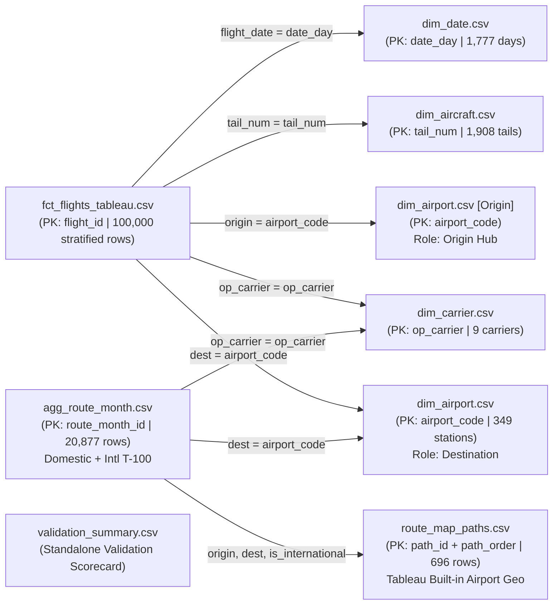

# Tableau Public Dashboard Specification & Wireframe (`docs/tableau_dashboard_spec.md`)

**Workbook Title:** **United Standby Opportunity Explorer (`ORD` Hub)**  
**Target Platform:** Tableau Public (`.twbx` packaged workbook backed by `exports/tableau/*.csv` extracts)  
**Data Scope:** `2019` (pre-COVID baseline) & `2023-01` – `2026-08` (`56` months; `830,941` domestic `ORD` `UA`-marketed flights stratified to `100,000` BI rows in `fct_flights_tableau.csv` + `20,877` domestic & international route-month segments in `agg_route_month.csv`)

---

## 1. Mandatory Visible Disclaimers (Exact Copy for Dashboard Header & Footer)

Every published Tableau Public tab must display these four visible disclaimers prominently (header banner + persistent footer):

1. **Non-Probability Heuristic Disclaimer (Header Banner):**
   > **Standby Opportunity Index (0–100 Heuristic — NOT a Boarding Probability):** `soi_historical` and `soi_planning` are transparent 0–100 relative opportunity heuristics derived strictly from public U.S. government aviation datasets (BTS OTP, BTS T-100, FAA Aircraft Registry, TSA daily checkpoint throughput) and curated cabin seat references. **They do not represent a probability of boarding.** Public datasets do not contain United Airlines gate standby lists, pass priorities (`SA1P`/`SA2`/buddy pass), hire-date seniority, revenue standby/SDC counts, or weight-and-balance payload caps.

2. **OTP Signals & Modeled Adjustments Disclaimer (Header Banner / Tooltip Subtitle):**
   > **No Observed Flight-Level Passenger Loads:** BTS T-100 reports passenger loads strictly at the monthly `carrier × route × aircraft_type` level. All **hour-of-day and day-of-week differences come from BTS OTP operational signals** (schedules, delays, cancellations, same-day backup banks) **and modeled TSA / hour-block demand adjustments** (`tsa_demand_multiplier`, `hour_block_multiplier`, `est_lf_adjusted`, `est_open_seats_adjusted`) **— NOT from observed flight-level loads.**

3. **International Granularity & Multi-Brand Regional CPA Disclaimer (Map & Route Tables):**
   > **Scope & Granularity Notice:** Domestic `ORD` departures (`fct_flights_tableau.csv`) are modeled at the flight level. **International departures (`is_international = TRUE` in `agg_route_month.csv`) are reported strictly at the `route × month × operating carrier` grain (`data_granularity = 'route_month_only_v1'`)** because BTS On-Time Performance covers U.S. domestic flights only; flight-level international tracking via OpenSky Network / FlightAware AeroAPI is a documented v2 enhancement. On shared regional spokes (`is_shared_regional_spoke = TRUE`), `OO` (SkyWest), `YX` (Republic), and `2023 ZW` (Air Wisconsin) T-100 load factors reflect combined multi-brand regional operations across `UA`/`AA`/`DL`.

4. **Non-Affiliation Disclaimer (Persistent Footer):**
   > **Independent Project — Not Affiliated with United Airlines:** This analytics engineering portfolio project is an independent educational work and is **not affiliated with, endorsed by, or sponsored by United Airlines, Inc.** or its United Express regional partners.

---

## 2. Extract Data Model & Tableau Relationships (`exports/tableau/`)

Connect Tableau Desktop / Tableau Public to the CSV files in `exports/tableau/` using Tableau's multi-table **Logical Layer Relationships** (avoiding physical SQL joins that could fan out dimensions):



### Exact File Inventory & Relationship Keys

| Extract File | Primary Key | Relationship Key(s) to Fact / Aggregate | Notes |
|---|---|---|---|
| `fct_flights_tableau.csv` | `flight_id` | `dest`, `origin`, `op_carrier`, `tail_num`, `flight_date` | `100,000` stratified rows across `(year, month, op_carrier)` (`seed=42`); 51 BI columns |
| `agg_route_month.csv` | `route_month_id` | `dest`, `op_carrier`, `(origin, dest, is_international)` | All `20,877` UA-family route-months (`18,577` domestic + `2,300` international) |
| `dim_airport.csv` | `airport_code` | `airport_code` | `349` airports with parsed `city_name`, `state_or_country`, `country_code`, `is_hub` |
| `dim_aircraft.csv` | `tail_num` | `tail_num` | `1,908` observed tails with `fleet_subtype`, `seats_config`, `source_url`, `as_of` |
| `dim_carrier.csv` | `op_carrier` | `op_carrier` | `9` UA-family carriers (`UA`, `OO`, `YX`, `YV`, `G7`, `C5`, `ZW`, `EV`, `AX`) |
| `dim_date.csv` | `date_day` | `date_day` | `1,777` days (`2019`, `2023–2026`) with `is_holiday_window`, `holiday_name`, TSA metrics |
| `route_map_paths.csv` | `(path_id, path_order)` | `(origin, dest, is_international)` | 2 rows per active `ORD` destination (`path_order`: `1=ORD`, `2=dest`); uses Tableau `Airport` geo role |
| `validation_summary.csv` | *(scorecard)* | Standalone data source | Summarizes Pillar 1 backtest, Pillar 2 face validity, Pillar 3 weight sensitivity, `SC-5` |

> **Important Null-Handling Rule (`2019` & `is_cancelled`):**
> - In `fct_flights_tableau.csv`, **`2019` flights strictly have `soi_planning = NULL`** (no prior training year in scope), and **cancelled flights (`is_cancelled = TRUE`) strictly have `soi_historical = NULL`**.
> - Tableau aggregations (`AVG`, `MEDIAN`) automatically ignore `NULL`s, but tooltips and summary cards must display `N/A (2019 baseline — no prior training year)` or `N/A (Cancelled flight)` rather than coalescing `NULL` to `0`.

---

## 3. Parameter & Tableau Calculated Fields

### 3.1 Parameter
- **`[Index Mode]`** (String List):
  - `'Planning (Leakage-Free)'` *(Default — for prospective trip planning across `2023–2026`)*
  - `'Historical (Post-Hoc)'` *(For retrospective audit across `2019` & `2023–2026` completed flights)*

### 3.2 Exact Calculated Fields (referencing exact CSV column names)

| Calculated Field Name | Exact Tableau Formula | Purpose |
|---|---|---|
| **`Selected SOI`** | `IF [Index Mode] = "Planning (Leakage-Free)" THEN [soi_planning] ELSE [soi_historical] END` | Primary 0–100 score bound to `[Index Mode]` |
| **`Selected Open Seats Score`** | `IF [Index Mode] = "Planning (Leakage-Free)" THEN [s_open_plan] ELSE [s_open_hist] END` | $S_{\text{open}}$ (`50%` weight) |
| **`Selected Displacement Score`** | `IF [Index Mode] = "Planning (Leakage-Free)" THEN [s_disp_plan] ELSE [s_disp_hist] END` | $S_{\text{disp}}$ (`20%` weight) |
| **`Selected Backup Score`** | `IF [Index Mode] = "Planning (Leakage-Free)" THEN [s_backup_plan] ELSE [s_backup_hist] END` | $S_{\text{backup}}$ (`20%` weight) |
| **`Selected Demand Score`** | `IF [Index Mode] = "Planning (Leakage-Free)" THEN [s_demand_plan] ELSE [s_demand_hist] END` | $S_{\text{demand}}$ (`10%` weight) |
| **`KPI Load Factor (Adj)`** | `AVG(IF NOT [is_cancelled] THEN [est_lf_adjusted] END)` | §9 Load Factor KPI (performed flights; format `0.0%`) |
| **`KPI Base T-100 Load Factor`** | `AVG(IF NOT [is_cancelled] THEN [est_load_factor] END)` | Unadjusted T-100 LF reference (performed flights; format `0.0%`) |
| **`KPI Delay Rate (Dep 15+)`** | `AVG(IF NOT [is_cancelled] THEN IIF([dep_delay_min] >= 15, 1.0, 0.0) END)` | §9 Delay Rate KPI (`>= 15 min` departure delay among performed flights; format `0.0%`) |
| **`KPI Cancellation Rate`** | `AVG(IIF([is_cancelled], 1.0, 0.0))` | §9 Cancellation Rate KPI across all scheduled flights (format `0.0%`) |
| **`KPI Avg Open Seats (Adj)`** | `AVG(IF NOT [is_cancelled] THEN [est_open_seats_adjusted] END)` | §9 Estimated Open Seats KPI (mean on performed flights; format `0.0`) |
| **`Period Group`** | `IF [year] = 2019 THEN "2019 Baseline" ELSE "2023-2026" END` | Separates pre-COVID 2019 baseline from post-COVID 2023–2026 |
| **`SOI 2019 Baseline (Historical)`** | `AVG(IF [year] = 2019 THEN [soi_historical] END)` | 2019 benchmark (`2019` always benchmarks against `soi_historical` because `2019 soi_planning` is `100% NULL`) |
| **`SOI vs 2019 Baseline Delta`** | `AVG(IF [year] >= 2023 THEN [Selected SOI] END) - AVG(IF [year] = 2019 THEN [soi_historical] END)` | Current-era `Selected SOI` minus `2019` historical baseline (`+0.0;-0.0;0.0`) |
| **`Load Factor vs 2019 Delta`** | `AVG(IF [year] >= 2023 AND NOT [is_cancelled] THEN [est_lf_adjusted] END) - AVG(IF [year] = 2019 AND NOT [is_cancelled] THEN [est_lf_adjusted] END)` | Current-era adjusted LF minus `2019` baseline LF (`+0.0%;-0.0%;0.0%`) |
| **`SOI Opportunity Band`** | `IF ISNULL([Selected SOI]) THEN "Unscored (Cancelled / 2019 Plan)" ELSEIF [Selected SOI] >= 75 THEN "High Opportunity (75-100)" ELSEIF [Selected SOI] >= 55 THEN "Moderate Opportunity (55-74)" ELSEIF [Selected SOI] >= 35 THEN "Tight (35-54)" ELSE "Constrained (0-34)" END` | Color/categorical tiering (explicitly avoids calling any band a probability) |
| **`Hour Block Order`** | `CASE [hour_block] WHEN "early" THEN 1 WHEN "morning" THEN 2 WHEN "midday" THEN 3 WHEN "afternoon" THEN 4 WHEN "evening" THEN 5 WHEN "late" THEN 6 END` | Forces chronological sorting `05:00` → `04:59` |
| **`Hour Block Display`** | `CASE [hour_block] WHEN "early" THEN "Early (05:00-07:59)" WHEN "morning" THEN "Morning (08:00-10:59)" WHEN "midday" THEN "Midday (11:00-13:59)" WHEN "afternoon" THEN "Afternoon (14:00-16:59)" WHEN "evening" THEN "Evening (17:00-19:59)" WHEN "late" THEN "Late (20:00-04:59)" END` | Clean axis labels |
| **`Day of Week Name`** | `CASE [day_of_week] WHEN 1 THEN "Mon" WHEN 2 THEN "Tue" WHEN 3 THEN "Wed" WHEN 4 THEN "Thu" WHEN 5 THEN "Fri" WHEN 6 THEN "Sat" WHEN 7 THEN "Sun" END` | Maps ISO `1..7` to weekday labels |
| **`Adjusted Open Seat Pct`** | `IF [seats_config] > 0 THEN [est_open_seats_adjusted] / [seats_config] END` | Open cabin % for tooltips |
| **`Shared Spoke Warning`** | `IF [is_shared_regional_spoke] THEN "Shared CPA Spoke (OO/YX/2023 ZW multi-brand T-100)" ELSE "UA-Dedicated Segment" END` | Visual warning badge on regional routes |
| **`Route Granularity Label`** | `IF [is_international] THEN "International: Route-Month Only (v1)" ELSE "Domestic: Flight + Route-Month" END` | Enforces `D-04` transparency |
| **`Holiday Regime Label`** | `IF [is_holiday_window] THEN [holiday_name] ELSE "Non-Holiday Baseline" END` | Peak vs. off-peak grouping |

---

## 4. Dashboard Wireframe & Core Views

### 4.1 Layout Wireframe (1400 × 1100 px Desktop Canvas, 4 Story Tabs)

*(All sample KPI values shown below are empirically computed directly from `exports/tableau/fct_flights_tableau.csv`: `100,000` flights, `98,032` performed.)*

```text
+---------------------------------------------------------------------------------------------------+
| UNITED STANDBY OPPORTUNITY EXPLORER (ORD HUB)                                [Index Mode: Plan v] |
| [!] DISCLAIMER: 0-100 Heuristic — NOT a Boarding Probability. Hour/day deltas reflect OTP signals |
|     & modeled TSA/hour-block adjustments, NOT observed loads. Intl = Route-Month Only (v1).      |
+---------------------------------------------------------------------------------------------------+
| GLOBAL FILTERS: [Dest/Region] [Carrier/Group] [Hour Block] [Year/Month/Holiday] [Fleet] [Scope]   |
+---------------------------------------------------------------------------------------------------+
| KPI STRIP (View 1):                                                                               |
|  Selected SOI | T-100 LF (Adj) | Dep Delay (15+) | Cancel Rate | Avg Open (Adj)  | Avg Backups    |
|   58.1 / 100  |  82.8% (82.0%) |      22.2%      |    2.0%     | 19.2 (Med 14.0) | 2.2 flts (M 1) |
+---------------------------------------------------+-----------------------------------------------+
| VIEW 2: ORD HUB-AND-SPOKE ROUTE MAP               | VIEW 3: HOUR-BLOCK x DAY-OF-WEEK HEATMAP      |
| (`route_map_paths.csv` + `agg_route_month.csv`)   | (`fct_flights_tableau.csv`)                   |
|                                                   |                                               |
|  * ORD hub -> 348 destinations (DOM + INTL)       |        Mon  Tue  Wed  Thu  Fri  Sat  Sun    |
|  * Color: Scope / Avg T-100 Load Factor           | Early  [72] [74] [73] [70] [66] [71] [69]    |
|  * Size: Departures Performed                     | Morn   [55] [59] [58] [54] [51] [60] [56]    |
|  * Click any spoke -> filters Views 3, 4, 5, 6, 9 | Mid    [58] [62] [61] [57] [53] [61] [57]    |
|                                                   | Aftn   [54] [58] [57] [52] [49] [59] [53]    |
|                                                   | Eve    [50] [54] [53] [48] [45] [56] [48]    |
|                                                   | Late   [66] [69] [68] [64] [61] [68] [63]    |
+---------------------------------------------------+-----------------------------------------------+
| VIEW 4: ROUTE & CARRIER DRILL-DOWN TABLE          | VIEW 5: HOLIDAY & TSA SEASONAL DEMAND CURVE   |
|  Dest | Carrier | Subtype | Seats | Open | SOI    |  Monthly / Holiday SOI vs TSA Multiplier      |
|  DEN  | UA      | B737-9  |  179  |  24  | 64.2   |  Late Jan Midweek (77.0) >> Thanksgiving (46) |
|  LHR  | UA      | (INTL)  |  --   |  --  | v1 R-M |  Overlay: S_open, S_disp, S_backup, S_demand  |
+---------------------------------------------------+-----------------------------------------------+
| VIEW 6: FLEET SUBTYPE & CABIN CAPACITY EXPLORER   | VIEW 7: INTL ROUTE-MONTH & VALIDATION SCORECARD|
|  31 Subtypes: 777-200 HD (364) vs CRJ-550 (50)    |  agg_route_month (is_international=TRUE) +    |
|  Seats Config vs Est Open Seats & Aircraft Source |  validation_summary.csv (rho=0.653, lift=5.31x)|
+---------------------------------------------------+-----------------------------------------------+
| VIEW 8: HISTORICAL TREND & 2019 BASELINE COMPARISON (`2019` soi_historical = 60.9 vs 2023-26)    |
|  Monthly line chart (`2019` reference band vs `2023–2026` `[Selected SOI]` & `[KPI Load Factor]`) |
+---------------------------------------------------------------------------------------------------+
| VIEW 9: FLIGHT-LEVEL DETAIL TABLE (`flight_id` grain | Confidence & T-100 Provenance Audit)       |
|  flight_id | flight_date | flt# | dest | op | tail | subtype | dep | open_adj | SOI | tier | lf_src|
+---------------------------------------------------------------------------------------------------+
| FOOTER: Independent Portfolio Project (BTS / FAA / TSA Public Data). Not affiliated w/ United.    |
+---------------------------------------------------------------------------------------------------+
```

### 4.2 Detailed Specification of the 9 Core Views

1. **View 1 — Executive KPI Strip & Validation Callout (`fct_flights_tableau.csv` + `validation_summary.csv`):**
   - Required §9 KPI Cards:
     - **Selected SOI:** `AVG([Selected SOI])` (`58.1` Planning / `61.7` Historical across `fct_flights_tableau.csv`)
     - **Load Factor:** `[KPI Load Factor (Adj)]` (`82.8%` performed) with sub-label `[KPI Base T-100 Load Factor]` (`82.0%`)
     - **Delay Rate (Dep 15+):** `[KPI Delay Rate (Dep 15+)]` (`22.2%` of performed flights)
     - **Cancellation Rate:** `[KPI Cancellation Rate]` (`2.0%` / `1.97%` of scheduled flights)
     - **Estimated Open Seats:** `[KPI Avg Open Seats (Adj)]` (`19.2` mean on performed; `MEDIAN(IF NOT [is_cancelled] THEN [est_open_seats_adjusted] END)` = `14.0` median in subtitle)
     - **Backup Options & Validation Callout:** `AVG([remaining_scheduled_backups])` (`2.2` flts mean / `1.0` median) alongside fixed methodology validation metrics from `validation_summary.csv` (Fixed Holdout Spearman $\rho = 0.6530$, Top-Decile Lift $= 5.31\times$, `SC-5` Violations $= 0$).
2. **View 2 — `ORD` Hub-and-Spoke Route Map (`route_map_paths.csv` + `agg_route_month.csv`):**
   - Primary zero-coordinate setup: Assign Tableau's built-in **`Airport`** geographic role to `route_map_paths.csv[airport_code]` (zero custom/invented coordinates per Ground Rule #1).
   - Marks: **Line**; Path = `path_order` (Dimension); Detail = `path_id`, `dest`, `scope_label`, `data_granularity`; Color = `AVG([avg_t100_load_factor])` (diverging blue-amber palette) or `is_international`; Size = `SUM([total_departures_performed])`.
   - *Optional Spatial Alternative:* If a workbook author joins external FAA/Tableau geocoded `origin_lat/lon` and `dest_lat/lon` tables, Tableau's `MAKELINE(MAKEPOINT([origin_lat], [origin_lon]), MAKEPOINT([dest_lat], [dest_lon]))` geometry calculation can draw geodesic great-circle arcs in place of `path_order` lines.
   - Action Filter: Clicking any destination filters Views 3, 4, 5, 6, 8, and 9 to `dest`.
3. **View 3 — Hour-Block × Day-of-Week Opportunity Matrix (`fct_flights_tableau.csv`):**
   - Rows: `[Hour Block Display]` sorted by `[Hour Block Order]`. Columns: `[Day of Week Name]` (`Mon`–`Sun`).
   - Text & Color: `AVG([Selected SOI])`, diverging green/gold/coral palette (`35`–`80`), tooltip showing all 4 component sub-scores (`S_open`, `S_disp`, `S_backup`, `S_demand`), `est_open_seats_adjusted`, `remaining_scheduled_backups`, and the reminder that intraday differences reflect OTP signals & modeled adjustments rather than observed loads.
4. **View 4 — Route & Carrier Drill-Down Table (`fct_flights_tableau.csv` + `dim_carrier.csv`):**
   - Grain: `(dest, op_carrier, fleet_subtype)` showing `COUNTD([flight_id])` (sampled flight count), `seats_config`, `[KPI Avg Open Seats (Adj)]`, `AVG([soi_planning])`, `AVG([soi_historical])`, `[KPI Delay Rate (Dep 15+)]`, `[KPI Cancellation Rate]`, and `[Shared Spoke Warning]` icon when `is_shared_regional_spoke = TRUE`.
5. **View 5 — Holiday & Seasonal Demand Curve (`dim_date.csv` + `fct_flights_tableau.csv`):**
   - Dual-axis / stacked breakdown comparing `is_holiday_window` / `holiday_name` regimes (`Thanksgiving`, `Christmas / New Year`, `Spring Break`, `Independence Day`, `Memorial Day`, `Labor Day`) against `Non-Holiday Baseline` and `Late Jan Midweek` trough, plotting `AVG([soi_historical])`, `AVG([soi_planning])`, and `AVG([tsa_demand_multiplier])`.
6. **View 6 — Aircraft Sub-Fleet & Cabin Capacity Explorer (`dim_aircraft.csv` + `fct_flights_tableau.csv`):**
   - Horizontal bar + boxplot across United's `31` curated fleet subtypes (`B777-200_HD` `364` seats down to `CRJ-200` / `CRJ-550` / `ERJ-145` `50` seats), comparing `seats_config`, `[KPI Avg Open Seats (Adj)]`, `AVG([Selected SOI])`, and `dim_aircraft.aircraft_source` provenance (`FAA_MASTER`, `FAA_DEREG`, `TAIL_OVERRIDE`).
7. **View 7 — International Route-Month Explorer (v1 Scope) (`agg_route_month.csv`):**
   - Filtered strictly to `is_international = TRUE` (`data_granularity = 'route_month_only_v1'`), listing `dest`, `dest_country`, `op_carrier`, `departures_performed`, `seats`, `passengers`, `t100_load_factor`, and `t100_seats_per_departure`, with an inline callout noting flight-level international tracking is deferred to v2 (OpenSky / FlightAware AeroAPI).
8. **View 8 — Historical Trend & 2019 Baseline Comparison (`fct_flights_tableau.csv` + `dim_date.csv`):**
   - Multi-year trend line (`month` on Columns, `AVG([Selected SOI])` & `[KPI Load Factor (Adj)]` on Rows, colored by `year` / `[Period Group]`) plus a constant dashed reference line for `[SOI 2019 Baseline (Historical)]` (`60.9` in `fct_flights_tableau.csv`), alongside `[SOI vs 2019 Baseline Delta]` (`+1.1` pts `2023–2026` vs `2019` on `soi_historical`) and `[Load Factor vs 2019 Delta]` (`+0.4 pp` `82.9%` vs `82.4%`).
   - Explicitly displays a subtitle note when `[Index Mode] = "Planning (Leakage-Free)"`: `2019` has `soi_planning = NULL` (no prior training year), so the 2019 benchmark always references `[soi_historical]` (`[SOI 2019 Baseline (Historical)]`).
9. **View 9 — Flight-Level Detail & Confidence Provenance Table (`fct_flights_tableau.csv`):**
   - Grain: Individual scheduled departure (`flight_id`, sorted by `flight_date DESC, crs_dep_time ASC`).
   - Displayed columns: `flight_id`, `flight_date`, `flight_num_mkt`, `dest`, `op_carrier`, `tail_num`, `fleet_subtype`, `crs_dep_time`, `est_open_seats_adjusted`, `Selected SOI`, `confidence_tier`, `record_confidence_summary`, `lf_source`, and `is_shared_regional_spoke`.
   - Purpose: Allows hiring managers and standby travelers to inspect exact flight-level estimates alongside their provenance (`record_confidence_summary = 'actual+derived+estimated'`, T-100 fallback tier `lf_source`, and `[Shared Spoke Warning]`), ensuring estimates are never mistaken for observed gate seat counts.

---

## 5. Interactive Filters & Controls (All 6 Required)

| # | Filter Control | Source Column(s) | Tableau Widget Type | Applies To |
|---|---|---|---|---|
| **1** | **Destination Airport / Region** | `dest`, `dim_airport.state_or_country`, `dim_airport.country_code` | Multi-select dropdown + map click action | Views 1–9 |
| **2** | **Operating Carrier** | `op_carrier`, `dim_carrier.carrier_group` (`MAINLINE` / `EXPRESS`) | Multi-select checklist | Views 1–9 |
| **3** | **Departure Hour Block** | `hour_block` (`early`, `morning`, `midday`, `afternoon`, `evening`, `late`) | Multi-select pills (chronological) | Views 1, 3–6, 8–9 |
| **4** | **Year / Month / Holiday Window** | `year`, `month`, `is_holiday_window`, `holiday_name` | Compact dropdowns + Holiday toggle | Views 1–9 |
| **5** | **Fleet Subtype** | `fleet_subtype` (`dim_aircraft.fleet_subtype`) | Searchable multi-select dropdown | Views 1, 3, 4, 6, 8–9 |
| **6** | **Scope (Domestic vs. International)** | `agg_route_month.is_international`, `scope_label` | Single/multi toggle (`DOM` / `INTL`) | Views 1, 2, 7 |

---

## 6. Tableau Public Publishing Checklist

1. Open Tableau Desktop / Tableau Public Desktop and connect to `exports/tableau/fct_flights_tableau.csv` + dimensions (`dim_airport.csv`, `dim_carrier.csv`, `dim_aircraft.csv`, `dim_date.csv`), plus a second logical connection for `agg_route_month.csv` + `route_map_paths.csv` and a third for `validation_summary.csv`.
2. Right-click `route_map_paths.csv[airport_code]` → **Geographic Role** → **Airport** (and set `path_order` to **Dimension** / Continuous Integer on the **Path** mark).
3. Verify `year`, `month`, `day_of_week`, and `dep_hour` are treated cleanly as Dimensions where used for slicing.
4. Create the `[Index Mode]` parameter and all 22 calculated fields from §3.2.
5. Verify all 4 mandatory disclaimers (§1) appear visibly on the canvas and tooltips never display `NULL` planning (`2019`) or `NULL` historical (cancelled) scores as `0`.
6. Create Extract (`.hyper`), save as packaged workbook (`.twbx`), and publish to Tableau Public with data-source attribution (`BTS OTP`, `BTS T-100`, `FAA Registry`, `TSA Checkpoint`).
